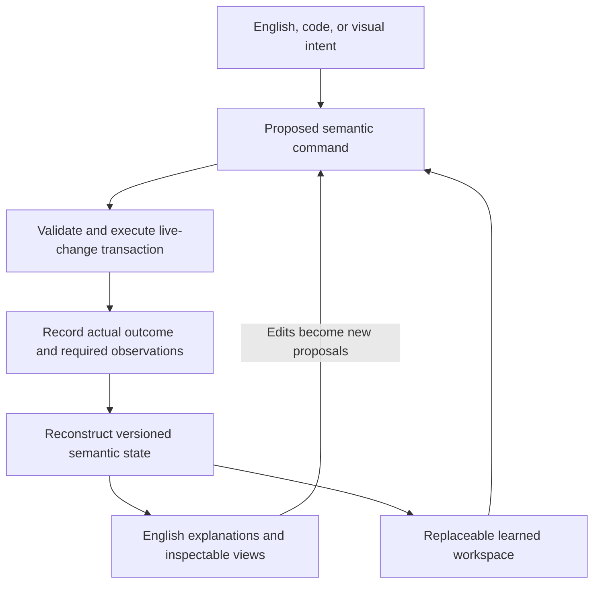

# ADR 0001: Explicit semantic state with replaceable projections

Status: accepted as a provisional research baseline; not implemented.

## Decision

Use explicit, versioned semantic state and recorded transitions as Blob's initial
authoritative representation. English, code, and visual interfaces can express
intent and present views of that state. Learned workspaces remain replaceable
components for retrieval, analogy, interpretation, and proposals.

Separate how a system reasons, what it commits, and how people understand it.
The baseline does not assume those activities need the same representation.
It also does not establish a universal ontology, graph database, serialization
format, or implementation language.

## Rationale and alternatives

English supports intentions, explanations, and questions whose meaning is still
being negotiated. Its interpretation can vary with context and model version.
An accepted state change needs an explicit identity and meaning that survives
rewording, interface changes, and replacement of an oracle.

Anthropic's J-space research identifies internal representations through their
potential for verbal report and investigates their role in reasoning. Its lens
depends on model activations and vocabulary. It does not establish a complete,
portable application-state format. The shared-workspace idea motivates an
experiment; adopting latent coordinates as the sole durable record is not yet
justified. See the [primary paper](https://transformer-circuits.pub/2026/workspace/).

The [representation experiment](../../experiments/representation-comparison/README.md)
owns the alternatives, tasks, and measurements used to challenge this decision.
No local comparison results are available.

## Authoritative meaning and storage

Begin with the identities, versions, definitions, relationships, state layouts,
constraints, and evidence links needed by the streaming-filter experiment.
Keep intent, hypotheses, and observations distinct from established facts.
Retain original text, ambiguous requests, unresolved alternatives, and opaque
artifacts when their meaning has not been formalized. Serialization alone does
not define semantics; versioned contracts and the reference interpretation do.

For the declared replay scope, preserve an initial state or checkpoint, ordered
committed transitions, required external observations, and the exact semantic
and implementation versions needed to reconstruct logical state. A materialized
state view must agree with that history. Do not create independently editable
copies of the same authoritative fact.

Define state publication and event persistence as one recoverable logical commit.
Crash recovery must not expose a published change with no recoverable record, or
claim completion for an unpublished transition. The concrete transaction and
checkpoint mechanisms remain open. This does not require logging every internal
instruction or making every repository file an event-sourced object.

## Intent, command, outcome, and view

1. Preserve the incoming English request, source edit, or graphical action and
   its relevant context.
2. Translate it into a proposed semantic command with target identities, base
   versions, explicit parameters, and any unresolved choices.
3. Validate the command against the current contract and state. Resolve material
   ambiguity before committing; reject stale proposals or rebase and revalidate.
4. Run the declared live-change transaction and record its actual outcome,
   resulting version, state identity, and supporting evidence. A command being
   accepted for execution does not mean migration succeeded.
5. Derive read views from the committed state and history, identifying the version
   they describe. An edit to a view starts a new command; it is not a direct write
   into authoritative state.

This borrows the separation of update and read models from
[CQRS](https://martinfowler.com/bliki/CQRS.html) and reconstruction from recorded
changes from [event sourcing](https://martinfowler.com/eaaDev/EventSourcing.html).
These are separate choices and can be prototyped in one process and store.

For example, “double the filter's history without losing existing samples” becomes
an explicit capacity change from 64 to 128 for an identified buffer version,
with a named migration and replacement boundary. The committed outcome records
whether it succeeded. Its explanation must distinguish preserving available
samples from reconstructing samples already discarded.

## Projection and learned-workspace requirements

- Ground factual explanations in identifiable state versions and evidence.
  Distinguish recorded facts, uncertain interpretations, and proposed changes.
- Detect stale views through version preconditions. Neither English regeneration
  nor a graphical edit may bypass validation.
- Treat free-form explanations as potentially lossy views. Preserve source intent
  and offer access to exact records; do not assume an English round trip is exact.
- Replay accepted commands, observations, and outcomes under the original rules
  without asking an oracle to reinterpret the original request. Route effects
  through the recorded or simulated sink rather than repeating external actions.
- Distinguish logical replay from byte-identical prose regeneration. Store exact
  generated text when it becomes input to a decision or is part of the claim.
- Record learned-artifact hashes, encoder/model/tokenizer or lens identities,
  configuration, and the actual proposal or observation used. Preserve latent
  state when required for the claim; an embedding is not a stable entity ID.
  Logical replay of recorded outputs does not prove repeatable latent reasoning.
- A model or representation change must not silently reinterpret old state.
  Preserve the old interpretation or define an explicit, validated migration.

Use structured records to support current status views while keeping authored
rationale and open questions in prose. This decision does not require generating
every whitepaper paragraph or converting every concept into a fixed schema.

## Reversal criteria and next evidence

Revisit the choice if another representation meets the same replay, migration,
inspection, and provenance requirements with materially better task outcomes or
lower total cost. Also revisit it if the explicit model persistently loses
important intentions or prevents useful mechanisms from being expressed.

Apply these reversal criteria using the
[comparison's measurements](../../experiments/representation-comparison/README.md#measurement-and-decision).
Representation extensions enter new versioned comparisons; this baseline does
not restrict what architecture discovery may propose.
