# Research plan for a continuously reprogrammable blob

*A deterministic system with a nondeterministic model oracle*

*Architecture experiments for an RTX N1X and WSL laboratory*

Research proposal · Version 6 · 31 October 2026

## Contents

- [1. Architecture to test](#1-architecture-to-test)
- [2. Semantics of a live change](#2-semantics-of-a-live-change)
- [3. Hypotheses and open design choices](#3-hypotheses-and-open-design-choices)
- [4. Lessons from live software systems](#4-lessons-from-live-software-systems)
- [5. Lessons from hardware and search projects](#5-lessons-from-hardware-and-search-projects)
- [6. Admit the N1X and WSL platform](#6-admit-the-n1x-and-wsl-platform)
- [7. Container laboratory and reproducibility](#7-container-laboratory-and-reproducibility)
- [8. CUDA as a general discovery engine](#8-cuda-as-a-general-discovery-engine)
- [9. Simulation and emulation evidence](#9-simulation-and-emulation-evidence)
- [10. Benchmarks that include change](#10-benchmarks-that-include-change)
- [11. Measurement and acceptance procedure](#11-measurement-and-acceptance-procedure)
- [12. Wisdom tree for live replacement](#12-wisdom-tree-for-live-replacement)
- [13. Wisdom tree for specialization](#13-wisdom-tree-for-specialization)
- [14. Wisdom tree for choosing a search method](#14-wisdom-tree-for-choosing-a-search-method)
- [15. Evolutionary architecture search procedure](#15-evolutionary-architecture-search-procedure)
- [16. Staged programme and decision gates](#16-staged-programme-and-decision-gates)
- [17. Experiment records and operating routine](#17-experiment-records-and-operating-routine)
- [18. Transformer models in the blob](#18-transformer-models-in-the-blob)
- [19. Determinism and oracle replay](#19-determinism-and-oracle-replay)
- [20. Broaden the search before selecting the architecture](#20-broaden-the-search-before-selecting-the-architecture)
- [21. Cross-project experiment portfolio](#21-cross-project-experiment-portfolio)
- [22. Wisdom graphs, search diversity, and new architectures](#22-wisdom-graphs-search-diversity-and-new-architectures)
- [23. Expanded research atlas](#23-expanded-research-atlas)
- [24. References](#24-references)

Build an experimental system in which live definitions remain editable while execution becomes more specialized. Evaluate the complete experience of running, inspecting, changing, and continuing. Keep the final language, object model, processor, and physical implementation open until experiments provide a reason to choose them.

Blob names the whole proposed system: its live world, execution machinery, models, tools, and eventually configurable hardware. Oracle means a transformer or other nondeterministic proposal service. The reference evaluator is a separate deterministic implementation of the declared semantics.

### Recommended first commitment

Create a small executable reference model, a replayable corpus of edits, and two interchangeable execution paths. The first experiment is a running numerical pipeline whose parameter, operation, and state layout can be changed through one interface. Measure the quantity and quality of useful results produced over the entire editing session, together with responsiveness, inspectability, and state continuity. Include compilation, waiting, migration, failed or discarded work, recovery, and human intervention in the session's costs.

### What this plan delivers

- A research architecture and explicit contracts for changes to running computations.

- A staged container laboratory for native CPU execution, CUDA discovery and execution, functional emulation, and architectural simulation.

- Three evidence based wisdom trees and procedures for updating them after each experiment.

- A benchmark suite, search strategy, acceptance gates, and a source map connecting past projects to tradeoff decisions.

### Starting evidence and boundaries

You report an RTX N1X with working CUDA in WSL. This is the starting observation. The exact Windows build, WSL package, distribution, CPU architecture, CUDA stack, RAM, and container behavior must be inventoried locally. No commands in this plan have been run on that machine. Commands are procedures for the laboratory; proposed harness names and schemas are specifications to implement.

The host GPU supplies compute for experiments. CUDA does not make its physical architecture reprogrammable. New processors and fabrics will initially exist as executable models. Hardware performance, area, and energy claims require additional calibration or physical evidence.

Numbered references identify primary papers and project documentation. Historical results are precedents, not performance predictions for this proposal. Proposed targets and search budgets are experimental starting values.

## 1. Architecture to test

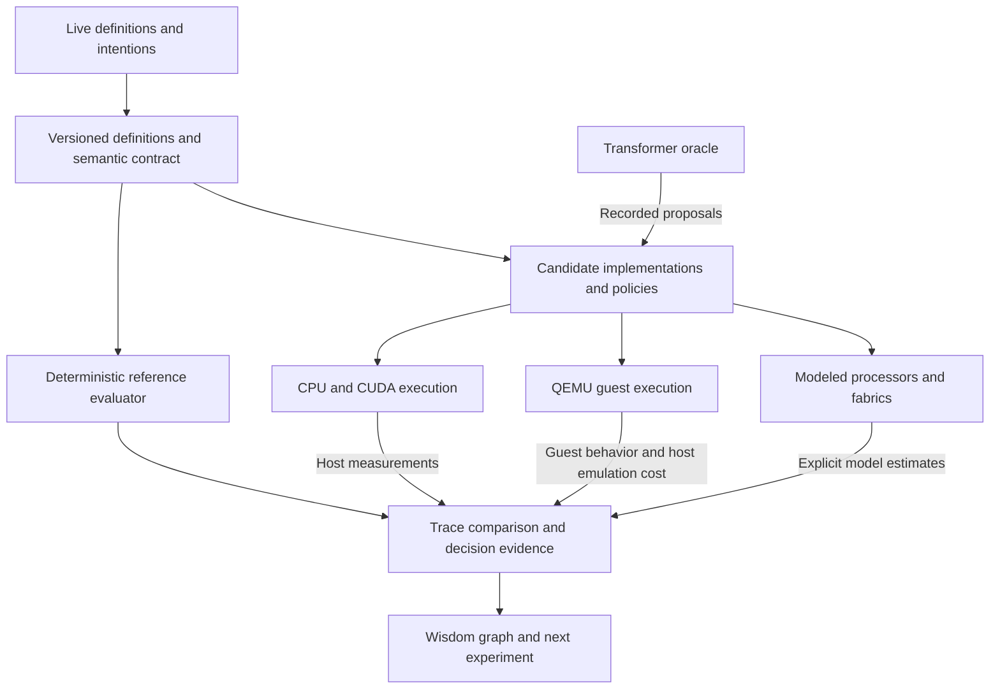

*Figure 1. The laboratory compares implementations against common semantics and recorded edits. Host measurements and modeled hardware results remain separate.*

Use a compact semantic core to define values, state, messages, effects, inspection, and changes. Describe frontends and backends through versioned interfaces. A Lisp, Smalltalk, visual, or new syntax can express the same initial experiments without becoming the definition of the research problem.

The provisional representation baseline is explicit, versioned semantic state with recorded transitions. English, code, and graphical interfaces express intentions and present views of that state; learned workspaces can support retrieval, analogy, and proposals. Separate the representation used to reason from the state that is committed and the views used to understand it. No implementation or local comparison yet establishes this choice as superior. The [representation decision](../decisions/0001-semantic-state-and-projections.md) records its rationale, requirements, and reversal criteria.

Begin with stable identities, definitions, typed relationships, state layouts, constraints, and evidence links needed by the first experiment. Preserve source intentions, ambiguity, hypotheses, and opaque artifacts where meaning has not been formalized. A graph or serialization format does not itself define semantics, and a fixed initial ontology must not become the boundary of architecture discovery. Keep authored explanations and open questions in prose; structured state does not require generating every research document.

The distinction between update commands and read views borrows from CQRS; reconstructing state from recorded changes is the separate event-sourcing choice [112][ref-112], [113][ref-113]. Prototype these boundaries in a single process and store if sufficient. An English interpretation proposes a command, validation and execution determine its outcome, and a projection describes committed state. Editing a projection must start a validated change, not bypass the semantic contract.

| Component | Required contract |
| --- | --- |
| Live description store | Stable identities, definition versions, source provenance, dependencies, and a readable change history. |
| Authoring and projection interfaces | Preserve intent; propose version-conditioned commands; identify the state and evidence behind each view; distinguish facts from generated interpretation. |
| Reference evaluator | A slow, clear deterministic implementation of specified observable behavior. Its host speed is not the performance baseline. |
| Execution regions | Explicit input, output, state, effects, valid assumptions, replacement boundary, and resource ownership. |
| Change manager | Prepare, validate, reach a boundary, migrate if needed, publish a version, and retire old state. |
| Backend interface | Execute, inspect, export state, import state, cancel or drain, report costs, and reject unsupported transitions. |
| Two policy loops | A bounded fast controller selects available implementations. A background process searches new ones. |

Treat optimized machine code and circuits as derived artifacts. The same live definition remains authoritative before and after compilation; specialization is ongoing maintenance, with no separate production model. Retain metadata to connect artifacts to definitions and reconstruct supported logical state. Self and Truffle provide software precedents [1][ref-1], [2][ref-2], [3][ref-3]. Extending this across a new configurable machine is a hypothesis to test.

## 2. Semantics of a live change

Define replacement behavior before optimizing it. An edit can intentionally change program meaning; an optimization must preserve the meaning of the selected version. Compare a candidate against the reference after applying the same edit, rather than against the old program.

Keep intent, proposed command, acceptance for execution, and actual transaction outcome distinct. For example, “double the history without losing samples” needs an identified buffer version, explicit old and new capacities, a migration, and a replacement boundary. Preserve available samples without claiming to reconstruct discarded history. State publication and durable outcome recording must form one recoverable logical commit; an interrupted migration cannot be represented as a completed change merely because its command was accepted.

| Change class | Initial supported rule | Later experiment |
| --- | --- | --- |
| Parameter change | Apply at the next declared work boundary; attach a version to each result. | Fine grained updates with bounded propagation delay. |
| Compatible method change | New invocations use the new version. In flight work completes under its recorded version. | On stack replacement with explicit reconstruction maps. |
| State layout change | Pause the affected region; run a declared migration; validate invariants before publication. | Lazy migration, forwarding objects, or parallel versions. |
| Protocol or graph change | Specify how queued messages and edges map to the new version. | Coordinated publication across several regions. |
| ISA or runtime change | Start a new modeled machine version and transfer an agreed state format. | Hardware supported boundaries and state reconstruction. |

### Procedure for each transaction

1. Record the intended edit, scope, old and new versions, and expected behavior.
2. Build or select a candidate while the current version continues.
3. Validate interfaces and migration preconditions.
4. Bound incoming work and reach a declared safe point.
5. Export state, migrate it, and check invariants.
6. Publish the new version and record the first valid observable result.
7. Retire the old implementation only when no work refers to it.

A failed prepare or migration must leave the previous version usable. A failed post-publication transition needs an explicit recovery rule; reversing a state transform is not automatically possible. External effects such as device commands or network sends are represented by recorded mock effects in early experiments. Replaying history cannot undo a real external action.

Ginseng and Erlang release handling show why update points, data conversion, and dependency order matter [7][ref-7], [8][ref-8]. A pointer swap alone does not make a multi-region update atomic. The first prototype should use one region per transaction and expand only after its semantics are reliable.

### Live change sequence

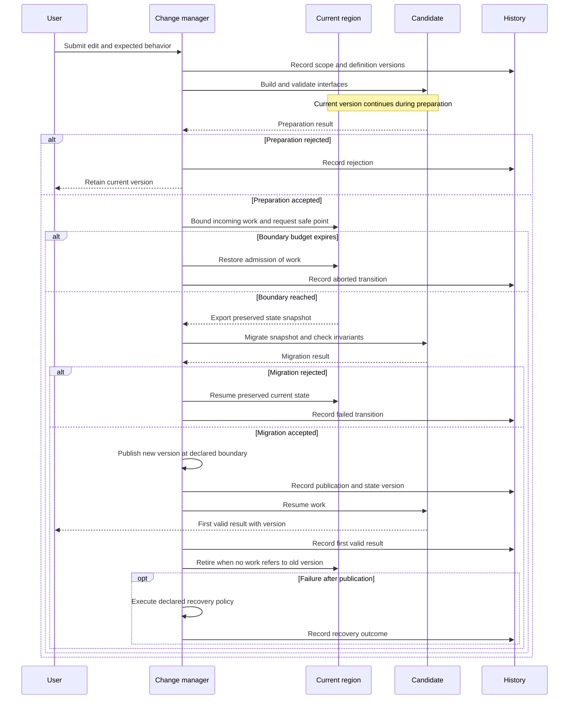

This sequence covers a stateful change to one region. Migration works on a snapshot or preserves the old state. Compatible method edits may instead let existing invocations finish under their old version. Post-publication recovery follows its declared policy; it is not assumed to be an inverse migration.

## 3. Hypotheses and open design choices

Keep three search spaces distinct: semantics, implementation, and adaptation policy. Freeze a semantic contract for a comparison run. A proposal that changes that contract starts a new experiment family with its own reference behavior.

Bound the time spent inside one hypothesis without making the initial architecture permanent. Preserve evidence identities across campaigns; freeze evaluation rules within a campaign; allow new representations, semantics, and workloads through explicitly versioned campaigns with new baselines. A candidate cannot change the acceptance rules judging its own result. The repository's [autonomous research policy](../guides/autonomous-research.md) defines the operational boundaries and provisional allocation defaults; sections 15, 17, and 22 explain their research role.

| Hypothesis | Competing designs | Discriminating evidence |
| --- | --- | --- |
| H1 Local replacement is enough | Call boundaries; actor turns; explicit safe points; arbitrary frame reconstruction. | Edit wait, pause, metadata cost, and types of edits supported. |
| H2 Reflection can be inexpensive | Always materialized state; lazy reconstruction; selective instrumentation. | Inspection correctness and latency under optimized execution. |
| H3 Isolation need not destroy liveness | Shared object world; isolated mutable regions; immutable messages with capabilities. | Latency, failure containment, migration scope, and debugging effort. |
| H4 Specialization should predict edits | Hotness only; hotness plus expected stability; user supplied lifetime hints. | Useful work over changing sessions and wasted optimization effort. |
| H5 New hardware primitives help | Stack or tagged processor; coarse dataflow fabric; mixed regions; ordinary CPU control. | Modeled cycles, state transfer volume, routing pressure, and cost sensitivity. |
| H6 Search earns its cost | Heuristic; random; local; Bayesian; evolutionary. | Held out quality at equal total evaluation budgets. |
| H7 A unified interface improves construction | Text editor; live inspector; direct graphical editing plus semantic presentations. | Task completion, hidden state, restart count, and edit mistakes. |

### Design space discipline

Do not combine all choices at once. Start with H1 and H4 on one stateful pipeline. Vary a single factor, then selected interactions. Retain explicit controls: no optimization, simple fixed tiering, and a fast conventional compiled implementation. The latter tests whether the proposed machinery provides enough value to justify its overhead.

A new architecture is allowed to add primitives. Require each new primitive to state its semantics, state footprint, replaceability, cost model, and the workload it is expected to improve. Keep a small exploratory budget for candidates that challenge the current architecture grammar.

## 4. Lessons from live software systems

Read the cited source for the mechanism, then reproduce a small behavior rather than porting an entire historical system. The questions below are interpretations for this research programme.

| Precedent | Lesson and tradeoff | Experiment |
| --- | --- | --- |
| Self [1][ref-1], [2][ref-2] | Adaptive compilation and deoptimization reconcile liveness with optimization. Metadata and safe interruption still have costs. | Inline a changing method; measure invalidation fanout and reconstruction delay. |
| Truffle [3][ref-3] | Specialize an interpreter using stable observations; repeated invalidation can erase gains. | Compare hand written specialization with partial evaluation for a small operation graph. |
| Morphic and Squeak [4][ref-4], [5][ref-5] | A running graphical object can be the point of entry for changing its structure and behavior. | Edit a live scene and inspect its backing state while animation continues. |
| Genera VLM [6][ref-6] | Machine semantics can preserve language level services across hardware implementations. | Model tags and barriers in a virtual processor; measure their logical benefits and modeled costs. |
| Erlang OTP [7][ref-7] | Supervision, explicit process state, and upgrade procedures give useful boundaries. | Compare per actor replacement with a shared object image. |
| Ginseng [8][ref-8] | Practical updates require analyses, update points, and data conversion; supported safety properties are scoped. | Inject a schema change during a request and verify old/new state consistency. |
| CLIM and GT [9][ref-9], [10][ref-10] | Semantic presentations and contextual tools make running objects inspectable in different forms. | Use one object as text, a graph node, and a command argument; measure consistency. |

### What to retain from these precedents

Preserve source identity through execution; make in flight state explicit; allow rich inspection; and measure the actual cost of keeping those abilities. Existing projects establish mechanisms, not the best combination for this machine. Common Lisp and CLOS remain candidates for implementing a reflective world, while a new core can be evaluated through the same contracts.

Avoid adopting a large VM or historical operating system merely for authenticity. First reproduce the feature that affects a decision. A small result that rejects an expensive approach is a useful milestone.

## 5. Lessons from hardware and search projects

| Precedent | Useful principle | Boundary to test |
| --- | --- | --- |
| Plasticine [11][ref-11] | Co-design compute and memory units around parallel patterns instead of assuming a conventional CPU or bit level fabric. | Test irregular object access and frequent edits, beyond the original workload family. |
| Spatial [12][ref-12] | Expose memory placement and scheduling in a higher level accelerator language. | Compare explicit annotations with inferred mappings and include programmer effort. |
| FPGA overlays [13][ref-13] | A programmable intermediate fabric can shorten mapping and configuration time. | Measure the flexibility tax in utilization, routing, and modeled execution cost. |
| CIRCT and Chipyard [14][ref-14], [15][ref-15] | Reusable representations and generators make architectural variants easier to construct. | Tool support and generator convenience must not predetermine the winning ISA. |
| Taalas [16][ref-16] | Specialization can remove substantial general execution machinery. | Use as an efficiency reference; fixed model silicon does not satisfy the reprogrammability requirement. |
| Ansor [17][ref-17] | Evolutionary search and learned cost models can find useful implementation schedules. | Count tuning effort and verify transfer to edited and held out workloads. |
| BOHB and NSGA II [18][ref-18], [19][ref-19] | Allocate evaluation budgets and retain alternatives on a multiobjective frontier. | Validate short trace rankings before pruning; compare with simple searches. |
| Thompson [20][ref-20] | Evolution can exploit properties of its evaluation medium outside conventional abstractions. | Test independent models and perturbed costs to expose simulator specific tricks. |

A wisdom tree is a living graph of decisions supported by these lessons and local results. Each branch records why it exists, its applicable workload, evidence strength, rejected alternatives, and the next experiment that could reverse the choice. A literature claim remains a precedent until reproduced under the relevant contract.

Track evidence as P for a primary source, L for a local measurement, M for a modeled estimate, and H for a hypothesis. Never silently promote an M result into a physical hardware claim.

## 6. Admit the N1X and WSL platform

Preserve the working CUDA installation and record its actual behavior. Native Windows Arm CUDA support is now documented in CUDA 13.4 release notes, but that alone does not certify every ARM64 WSL and container combination [21][ref-21]. Treat your working WSL CUDA path as a local observation to reproduce.

### Run in Windows PowerShell

```powershell
Get-CimInstance Win32_ComputerSystem |
  Select-Object Manufacturer, Model, SystemType, TotalPhysicalMemory
Get-ComputerInfo |
  Select-Object WindowsProductName, OsBuildNumber, OsArchitecture
wsl --version
wsl --status
wsl --list --verbose
nvidia-smi
```

### Run inside the selected WSL distribution

```bash
uname -a
uname -m
cat /etc/os-release
lscpu
free -h
ls -l /dev/dxg
nvidia-smi
nvcc --version
docker context show
docker version
docker info --format '{{.OSType}}/{{.Architecture}} {{.ServerVersion}}'
```

Record missing commands rather than interpreting them as a failed GPU. A missing nvcc can coexist with a working framework CUDA runtime. If nvidia-smi is absent from PATH, try /usr/lib/wsl/lib/nvidia-smi. The WSL package version and the distribution mode are different: wsl --list --verbose reports WSL 1 or WSL 2 [23][ref-23].

Use the existing Windows-provided GPU driver path. NVIDIA instructs WSL users not to install a Linux GPU driver into WSL [22][ref-22]. Record the distro, driver, toolkit, runtime and compute capability separately. Do not guess an architecture number or replace a working stack to match a sample command.

Gate G0 requires a saved inventory, a native CPU container test, a checked CUDA calculation inside the selected container, and a repeatable baseline. If container GPU access fails, continue CPU research and isolate that integration issue. The architecture programme need not stop.

## 7. Container laboratory and reproducibility

Containers package reproducible experiments; they can run native processes, QEMU user-mode translation, full-system guest machines, or architectural simulators. Use one known Docker engine and record its context. Prefer a native container image for the emulator or simulator when available; its guest or modeled architecture may be different. Docker Desktop currently labels Windows Arm support Early Access [24][ref-24]. Foreign-architecture container execution is a separate compatibility path [25][ref-25], [34][ref-34], [35][ref-35].

| Lane | Contents and purpose | Output |
| --- | --- | --- |
| Reference | Small evaluator, property tests, trace replay, schema validation. | Expected outputs and logical state. |
| Native runtime | Candidate interpreters, baseline compilers or JITs; build only the candidate in use. | Host performance and edit costs. |
| CUDA | Verified devel image, runtime compilation probe, kernels, batched simulator. | Checked outputs and host GPU timings. |
| Architecture | Event simulator, QEMU or gem5 for the particular question. | Functional results or explicitly modeled cycles. |
| RTL | Verilator and selected CIRCT/synthesis tooling; optional until required. | Logic traces and structural estimates. |
| Analysis | Experiment ledger, statistical summaries, Pareto frontier and decision records. | A reproducible comparison report. |

These lanes are proposed build targets, not existing image names. Use separate container definitions with pinned tool releases or commits. Keep source and result directories in the WSL Linux filesystem, such as ~/reprogrammable-lab, as recommended for Linux tooling [26][ref-26]. Containers package dependencies; a new processor requires an emulator or simulator inside them.

### Admit a candidate CUDA image

Set LAB_GPU_IMAGE to a real devel tag selected for the measured driver and architecture. The following commands intentionally contain a placeholder; replace it before execution. Use the resulting repository digest for experiments.

```bash
export LAB_GPU_IMAGE='REPLACE_WITH_VERIFIED_DEVEL_IMAGE'
docker buildx imagetools inspect "$LAB_GPU_IMAGE"
docker pull --platform linux/arm64 "$LAB_GPU_IMAGE"
docker image inspect --format '{{.Architecture}} {{json .RepoDigests}}' \
  "$LAB_GPU_IMAGE"
docker run --rm --platform linux/arm64 --gpus all \
  "$LAB_GPU_IMAGE" nvidia-smi
```

Next run the numerical test in section 8 in an image that already contains the required framework, or build a small CUDA vector operation using the devel toolchain. GPU discovery alone is insufficient. Pin the platform, image digest, tool versions, source commit, seeds, and launch command together.

### Containers can host emulators and whole guest systems

Use two independent axes: **packaging** describes the container and its dependencies; **execution** describes what happens inside it. A container can run QEMU as an ordinary process. QEMU can then run a foreign-ISA program or a complete guest machine. The outer container does not have to use the guest's architecture. [34][ref-34], [35][ref-35]

| Execution inside a container | What actually runs | Useful research role |
| --- | --- | --- |
| Native execution | Programs compiled for the container host's ISA. | Reference evaluator, compiler, live UI, local CPU baseline. |
| Native CUDA execution | Host-side processes using the admitted WSL GPU path. | Real kernel experiments and acceleration of suitable simulators. |
| QEMU user mode | A foreign-ISA userspace program, with instruction and system-call translation. | Run legacy tools or language runtimes without booting a guest kernel. Supply the target ABI and libraries when required. |
| QEMU full-system emulation | A modeled CPU, memory, devices, firmware, and guest kernel under TCG. | Boot different operating systems, inspect machine state, test runtime/ISA interactions, or extend a machine model. |
| QEMU with a hardware accelerator | A guest using compatible host virtualization when actually available. | Faster supported guest execution; availability depends on the complete Windows/WSL/container/host configuration. |
| Custom interpreter, gem5, or RTL simulator | A chosen functional or timing model, implemented as a process. | Novel ISAs, tagged machines, graph reducers, CGRAs, and hardware primitives that existing QEMU targets do not implement. |

QEMU documents the user-mode and system-mode distinctions. Docker's multi-platform support also uses emulation, but selecting a foreign-platform container image is a different experiment from running a full-system QEMU guest inside a native container. [25][ref-25], [34][ref-34], [35][ref-35]

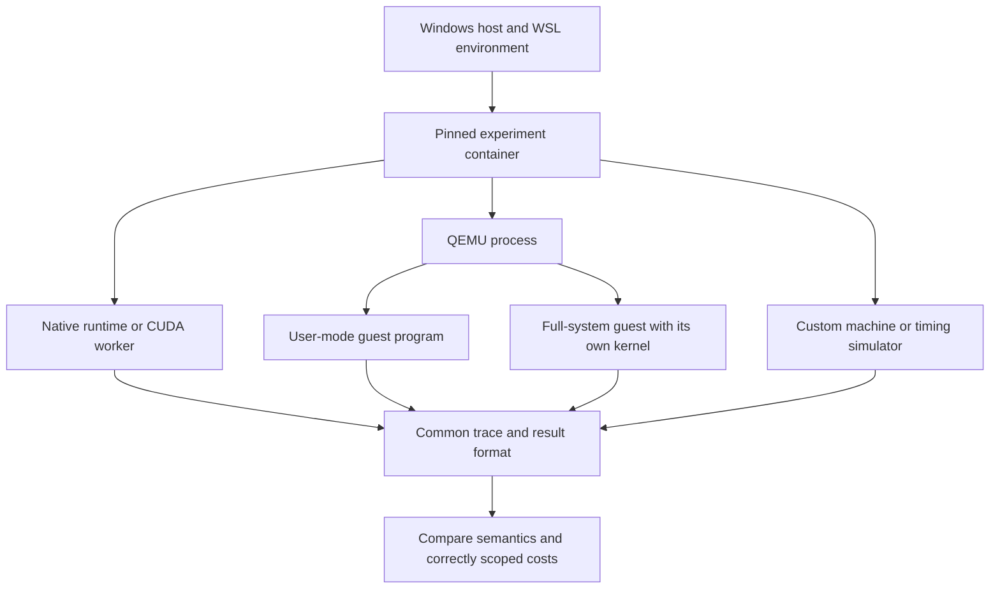

### Keep four architecture fields explicit

Record the physical host ISA, the ISA of the container's userspace binaries, the emulated guest ISA, and the modeled target architecture separately. On an admitted ARM64 host, a native ARM64 container can run an ARM64 build of `qemu-system-riscv64` that emulates RV64. Alternatively, an x86 userspace toolchain may itself run through user-mode translation. Record any nested translation because it affects development speed and compatibility.

For example, this is a **proposed manifest**, not a measurement of your machine:

```yaml
experiment_id: qemu-rv64-smoke-001
host_isa: REQUIRED_FROM_INVENTORY
container_userspace_isa: REQUIRED_FROM_IMAGE_MANIFEST
container_digest: REQUIRED
execution_kind: qemu_full_system
emulator_binary: qemu-system-riscv64
emulator_version: REQUIRED
accelerator: tcg
guest_isa: rv64
guest_machine: virt
firmware_hash: REQUIRED
guest_kernel_hash: REQUIRED
guest_initramfs_hash: REQUIRED
semantic_contract: boot_and_guest_trace_v1
evidence_scope: functional_guest_behavior
host_elapsed_time: RECORDED_SEPARATELY
target_cycle_model: none
```

### First containerized emulation procedure

1. Admit a pinned image containing a host-compatible QEMU binary and its firmware files. Run `qemu-system-riscv64 --version` and `qemu-system-riscv64 -machine help` inside that image.
2. Supply a known RV64 kernel and initramfs that match the `virt` machine. Preserve their hashes, configuration, and build provenance. RV64 is a convenient test guest here, not a commitment to the blob's eventual ISA.
3. Boot with TCG first. This lane does not require nested KVM. Record the boot log, guest architecture, and output of a tiny deterministic guest computation.
4. Execute the same logical test under the reference evaluator and compare outputs. Measure host emulation time separately from guest logical work.
5. Add debugger or machine-control access, state inspection, and guest snapshots only after the basic run succeeds. A VM snapshot is not a proof that arbitrary blob state can migrate between implementations.

The following is a **launcher template**. Before using it, replace `LAB_QEMU_IMAGE`, provide the two guest files, and verify that the image supplies the expected default OpenSBI firmware. The initramfs must contain a working `/init`. QEMU's target documentation supplies the board and boot semantics. [36][ref-36]

```bash
export LAB_QEMU_IMAGE='REPLACE_WITH_VERIFIED_QEMU_IMAGE_DIGEST'
docker run --rm -i \
  --mount "type=bind,src=$PWD/guest,dst=/guest,readonly" \
  "$LAB_QEMU_IMAGE" \
  qemu-system-riscv64 \
    -machine virt -accel tcg -m 512M \
    -nographic -bios default \
    -kernel /guest/Image \
    -initrd /guest/rootfs.cpio.gz \
    -append "console=ttyS0 rdinit=/init"
```

Use this to explore guest semantics, operating-system behavior, and instrumentation. QEMU instruction counting is not cycle-accurate processor timing. New instructions, devices, or tagged memory rules require an appropriate existing emulator or an explicit model extension. CUDA access in the outer container does not automatically become GPU access inside an emulated guest. [29][ref-29], [35][ref-35]

### Guest experiment sequence

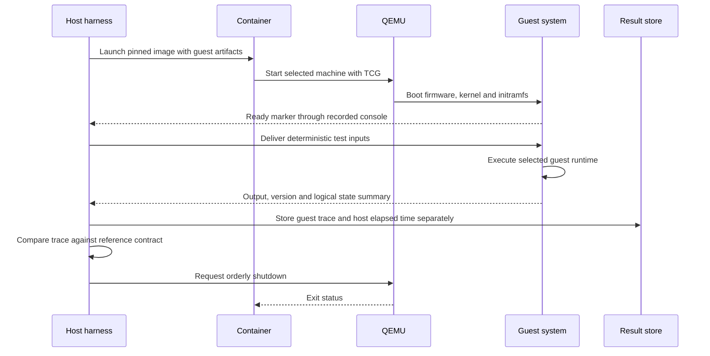

The concrete console, socket, or test transport must be specified in the harness. Do not infer deterministic guest execution merely from using QEMU; clocks, devices, scheduling, and external input still need the replay treatment in section 19.

## 8. CUDA as a general discovery engine

CUDA belongs throughout this research programme: simulation, program evaluation, testing, optimization, measurement, and eventually execution of parts of the blob. Transformer inference is one optional consumer. The main proposed mechanism is a reusable GPU evaluator that executes **candidate descriptions as data**, across many independent experiments.

The architecture below is a research proposal. CUDA supplies parallel execution mechanisms; it does not supply the proposed semantics, validator, or cost model automatically. No performance result for the reported N1X is claimed.

### 8.1 Three roles with separate evidence

| Role | What CUDA actually executes | What the result establishes |
|---|---|---|
| Discovery accelerator | Candidate evaluation, test generation, graph operations, numerical optimization, and statistical analysis. | How much useful research the laboratory completes per unit of time and compute. |
| Host for hypothetical machines | Models of VMs, actors, dataflow machines, caches, tagged memory, routing fabrics, and reconfiguration. | Behavior and estimated costs under the specified model. GPU runtime is the cost of evaluating that model. |
| Actual blob backend | A real interpreter, specialized kernel, renderer, signal processor, or scientific computation. | Local behavior and measured performance of that implementation on this GPU. |

A processor model that is cheap to simulate is not necessarily a cheap processor to build. Keep evaluator wall time, modeled target cycles, and actual implementation performance in separate fields. Physical area, energy, and timing require further calibration and implementation evidence.

### 8.2 Where parallel computation helps discovery

These are proposed experiments, not promises that every algorithm will run faster on a GPU. Parallelize **across independent trials first**. Parallelism inside a single irregular machine can be a later experiment.

| Research activity | CUDA workload | Decision it informs |
|---|---|---|
| Language and VM exploration | Batched small bytecode interpreters with different dispatch, tagging, object-layout, and continuation representations. | Which representations preserve inspection and cheap changes? |
| Actor and dataflow semantics | Queue-network models with message delivery, backpressure, failures, and live edits. | Which scheduling and state boundaries give useful deterministic behavior? |
| Memory and runtime design | Allocation/access traces, remembered sets, version retention, collection, and migration models. | What makes an editable object world expensive, and where should state live? |
| Hardware organization | Parameterized processing-element, routing, cache, and configurable-region models. | Which unit mixes, communication patterns, and replacement costs deserve RTL investigation? |
| Logic simulation | Many input waveforms through supported gate-level models; bit-packed Boolean evaluations where the semantics allow them. | Which proposed primitives are functionally sound, and what switching activity do they cause? |
| Program synthesis and superoptimization | Evaluate many candidate programs or rewrite sequences over shared input sets. | Which transformations are promising enough for independent equivalence checks? |
| Counterexample discovery | Enumerated small input spaces; batches of adversarial edits, faults, queue limits, and interleavings. | Where does a candidate violate its contract? Which failure should expand the corpus? |
| Graph processing and mapping | Frontier expansion, sorting, compaction, connectivity calculations, and batches of placement/routing scores. | Which partitions, mappings, and change boundaries reduce communication or invalidation? |
| Search and quality diversity | Population fitness, behavioral descriptors, neighborhood distances, archive binning, and budget allocation calculations. | Which search method finds varied useful candidates within the same total budget? |
| Uncertainty and sensitivity | Monte Carlo cost scenarios, parameter sweeps, bootstrap summaries, and robustness evaluation. | Does a winner survive uncertain memory, routing, migration, and compilation costs? |
| Continuous optimization | Differentiable simulators or explicit continuous relaxations; numerical fitting of cost models. | Which parameters merit exact discrete evaluation next? |
| Constructionist workloads | Real physics, geometry, image processing, signal processing, and visualization kernels under live edits. | Can people manipulate meaningful running systems while retaining responsive execution? |
| Optional learned proposals | Transformer inference or other learned proposal/surrogate models, measured as a separate component. | Does a learned component improve discovery enough to justify its cost? |

GPU-assisted testing is not a proof of unrestricted correctness. Exhaustion of a declared finite domain establishes only that bounded result. SAT/SMT, proof checking, and irregular symbolic rewriting can remain CPU services; a GPU port needs its own justification.

### 8.3 Proposed laboratory architecture

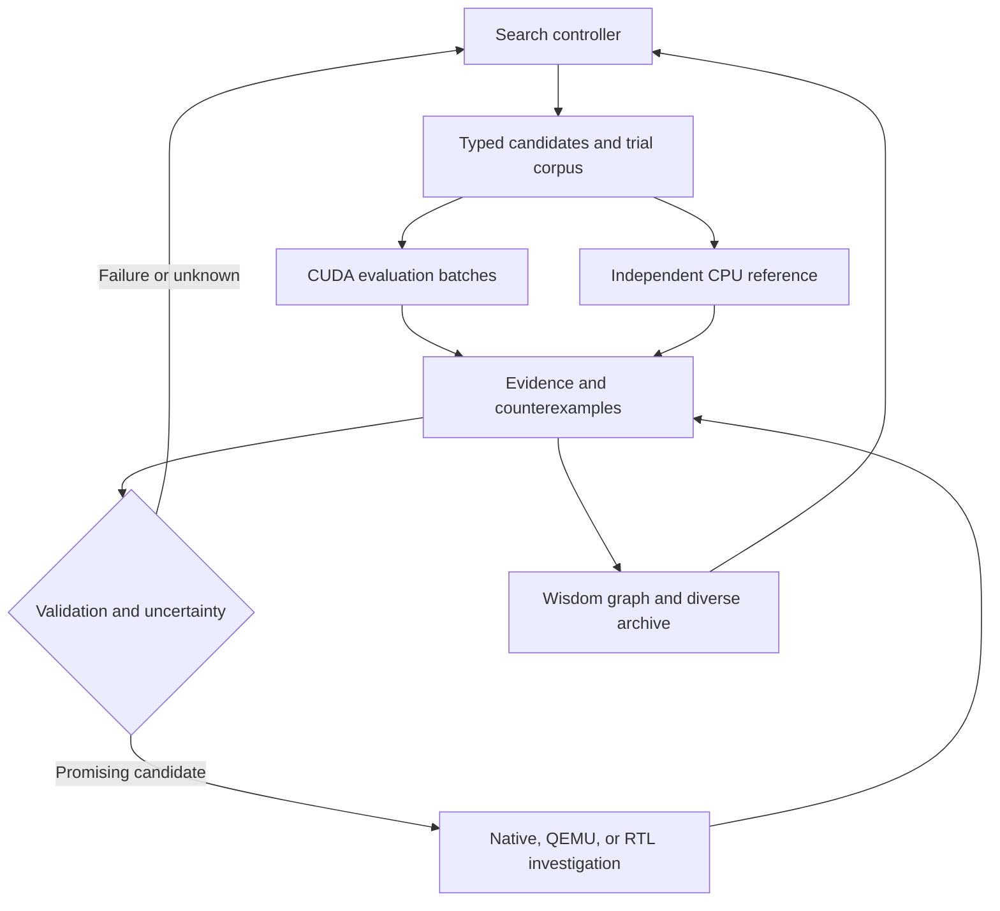

Build five small components: a versioned candidate format; an independently implemented CPU evaluator; one or more CUDA evaluation engines; a search controller; and an evidence archive. Their interchange format should survive replacement of any individual implementation.

Start with a bounded graph/queue machine. Candidate data contains operation codes, edges, state layouts, capacities, region boundaries, scheduling choices, and cost-model identifiers. Inputs include initial state, a workload trace, and edits at specified logical boundaries. Results include outputs, invariant failures, resource exhaustion, modeled counters, and diagnostic checkpoints.

Changes expressible in this grammar update data buffers. New compound operations can be graphs of existing operations. A genuinely new primitive or changed base semantics requires a versioned evaluator update and renewed validation. Keep the grammar editable through the procedure in section 22; otherwise search can only rediscover combinations already representable.

Use distinct names for the **candidate graph**, which describes a proposed computation or machine, and a **CUDA Graph**, which describes host GPU work submission. Updating one does not inherently update the other.

### 8.4 Candidate and trial contract

The following is a proposed record, not a ready-made tool interface:

```yaml
semantic_contract: bounded_graph_v1
candidate_hash: REQUIRED
grammar_hash: REQUIRED
evaluator_hash: REQUIRED
reference_hash: REQUIRED
cost_model_hash: REQUIRED
trial:
  workload_hash: REQUIRED
  edit_trace_hash: REQUIRED
  initial_state_hash: REQUIRED
  scenario_id: REQUIRED
  stimulus_stream_id: REQUIRED
  max_logical_steps: 100000
  queue_limit: 256
outputs:
  status: completed_or_counterexample_or_inconclusive
  logical_result_hash: REQUIRED
  first_failure: optional_trace_location
  modeled_metrics: separate_record
  evaluator_measurements: separate_record
```

Compute `logical_result_hash` over a canonical semantic projection, not raw heap bytes or allocation IDs. Different representations may encode the same logical state. Admit common cost scenarios outside the candidate: `cost_model_hash` records provenance and does not let a candidate choose an easier evaluator. Unsupported primitives require a justified model extension or an inconclusive result.

Use immutable descriptions for an in-flight batch. Apply research edits to a new candidate version and admit them at an explicit boundary. This makes an interrupted or superseded experiment recoverable. Record cancelled work as search cost.

Represent state using flat arrays and integer offsets initially. Compare structure-of-arrays and grouped layouts according to the chosen thread mapping. Bound queues, stacks, heaps, and trace buffers explicitly. Exceeding an evaluator bound returns **inconclusive**, unless violating that bound is itself the target contract being tested. Do not quietly truncate state or label every timeout a deadlock.

### 8.5 A concrete batch on the proposed evaluator

An illustrative generation could contain:

\[
256\ \text{candidates}\times12\ \text{workloads}\times8\ \text{edit/fault scenarios}\times4\ \text{stimulus seeds}
=98{,}304\ \text{jobs}.
\]

Each job runs a complete candidate/scenario combination. They can be processed in memory-sized chunks. This is a proposed workload size, not a claim about simultaneous GPU residency or measured throughput.

Compare three mappings:

| Mapping | Likely useful case | Main question |
|---|---|---|
| One thread per job | Tiny machines with mostly serial transitions. | Does packing many jobs outweigh divergent instruction paths? |
| One warp per job | A small graph with enough cooperative work per transition. | Does cooperation offset synchronization and idle lanes? |
| One block per job | Larger bounded graphs or state transitions. | Does per-job state consume too many resources for useful concurrency? |

For the warp mapping, 128 threads per block gives four jobs per block and 24,576 logical blocks for this batch. A 2 KiB state arena per job would occupy 192 MiB; a 64-byte summary per job another 6 MiB. These illustrative allocations exclude candidate data, inputs, queues, scratch space, and traces. Actual batch limits come from measured available memory and the evaluator's real allocation sizes. CUDA's thread/block organization provides these mapping choices [91][ref-91].

One proposed warp implementation lets lane 0 select a logical event while the other lanes evaluate independent portions of its transition. Define conflicting-write resolution and synchronization explicitly. Compare it with the simpler thread-per-job implementation. Bucket similar programs or state footprints to investigate divergence, but preserve logical trial identities when reordering jobs.

The first useful output is a table of semantic agreement and **end-to-end valid trials per second** across scalar CPU, parallel CPU, generic CUDA, and eventually specialized CUDA. This measures evaluator throughput; record discovery quality and application quantity/quality separately under section 11. A GPU loss on small or irregular batches is useful routing evidence.

### 8.6 Determinism is part of the evaluator design

1. **Define target semantics independently of CUDA scheduling.** For synchronous machines, read a current-state snapshot and write next state before committing. For event machines, define causality and simultaneous-event behavior. A stable order such as `(logical_time, phase, source_id, source_sequence)` is appropriate only when it matches the chosen semantics; it must not silently erase meaningful interleavings.
2. **Start with exact control state.** Specify bit widths, overflow, shifts, comparisons, and queue rules. Integer computation still needs race-free writes and defined overflow behavior.
3. **Index randomness by logical identity.** Share environmental stimulus streams across competing candidates. Key them by scenario and logical event; keep mutation streams separate. Pin the generator and consumption convention. cuRAND exposes seed, subsequence, and offset mechanisms, but a seed alone does not define a whole replay contract [92][ref-92].
4. **Declare the numerical guarantee.** Floating-point reassociation can change results. Use fixed evaluation/reduction order or validated reproducible primitives where needed. Fixed reduction order alone does not guarantee CPU/GPU bitwise equality: specify precision, FMA contraction, rounding, subnormal handling, and special values, or narrow the comparison contract. An approximate fitness estimate may guide exploration, while the strict execution contract remains separately enforced [93][ref-93].
5. **Record observations used by decisions.** Timing, device telemetry, oracle outputs, and surrogate scores can vary. Store the actual values used for admission and ranking; replay decisions from those records. Break ties explicitly, for example by candidate ID.
6. **Vary physical scheduling during validation.** Reorder batches and change legal launch shapes. Logical results should remain the same under the declared contract. CPU/GPU agreement from the same generated implementation is weaker evidence than an independent reference.

CCCL documents explicit determinism requirements for supported algorithms and types. Its guarantees are algorithm-specific; deterministic selection need not imply sorted output. Admit a pinned supported release and test the required operation rather than assuming every GPU primitive is deterministic. The referenced development documentation is a design guide, not an instruction to install an unstable package [94][ref-94].

Every primitive must pass independent reference tests. During exploration, replay selected intermediate candidates and every mismatch on the CPU. Every finalist must pass the full declared validation suite. Output hashes are compact diagnostics, not proofs; preserve enough state and trace data to investigate disagreement. For unbounded correctness claims, add an appropriate proof or explicitly limit the claim.

### 8.7 One discovery iteration

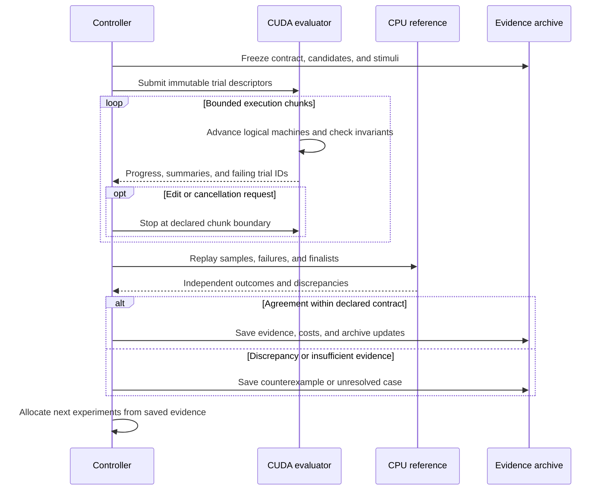

Maintain a resident corpus of inputs and edit traces where practical. Return summaries frequently; collect large traces for failures, representative cases, and finalists. Launch bounded chunks so progress, cancellation, inspection, and resource sharing remain observable. A logical-step bound does not itself bound wall time. Choose chunk sizes using measured worst-case transition costs and the platform's kernel-duration constraints. A reusable interpreter and retained state do not require an indefinitely running kernel.

### 8.8 Use CUDA mechanisms where measurements justify them

| Mechanism | Proposed use | Evidence to collect |
|---|---|---|
| Resident buffers | Reuse corpus, cost tables, candidate state, and intermediate values. | Allocation footprint, transfer volume, and total iteration time. |
| Coalesced access and work bucketing | Match data layout to thread mapping and group compatible jobs. | Useful work, divergence, memory traffic, and preparation overhead. |
| Streams, events, bounded pinned buffers | Overlap independent batches when the actual platform permits it. | End-to-end overlap and resource consumption; do not assume it occurs. |
| CUDA Graphs | Reuse a stable reset/evaluate/summarize pipeline. | Submission savings and update/reinstantiation cost. |
| NVRTC specialization | Compile frequently reused evaluator patterns or stable candidate kernels in the background. | Compile, load, validate, install, warm-up, cancellation, and reuse costs. |
| CUB/Thrust primitives | Scan, sort, compact, and reduce event/frontier/fitness data. | Numerical and ordering guarantees, temporary memory, and crossover size. |
| Numerical kernels | Fit continuous cost models or optimize a declared relaxation. | Prediction error, conditioning, precision effects, and exact revalidation. |

NVIDIA's best-practices guidance supports minimizing transfers, retaining intermediates, and arranging coalesced accesses [90][ref-90]. CCCL supplies reusable parallel primitives [95][ref-95]. Even with physically shared memory, ownership, synchronization, migration, and cache behavior must be measured; do not infer the N1X memory configuration from its name.

CUDA Graph updates have restrictions and affect subsequent launches; incompatible changes need rebuilding. They do not provide arbitrary migration of a running computation [28][ref-28]. NVRTC compiles CUDA source at runtime and supports loading generated GPU code [27][ref-27]. These mechanisms allow an immediately executable generic path with optional background specialization. They need not create a user-visible prototype/runtime divide.

Compilation is worthwhile only when expected savings over the candidate's remaining useful life exceed compile, validation, installation, and invalidation costs. Treat that expectation as another measured policy hypothesis. Tensor-oriented hardware is useful for suitable numerical operations; it is not a generic accelerator for pointer-heavy object semantics.

### 8.9 Search methods and a CUDA wisdom tree

A genetic algorithm is one consumer of the evaluator. It is not required to balance reprogrammability and performance. Establish enumeration, random search, and local search controls first. Compare evolutionary search for structured discrete candidates, Bayesian methods for expensive evaluations, and quality-diversity methods when preserving different architectural families matters. Use gradients only for differentiable parameters or explicit relaxations; project back to discrete candidates and revalidate.

Give every search campaign a frozen evaluator, a declared editable scope, a total resource envelope, and a rule for leaving a stagnant lineage. Track proposal, build, validation, and failed-trial costs as well as CUDA evaluation. GPU throughput alone cannot justify extending a search that produces neither useful findings nor new evidence. Use the campaign and portfolio procedures in sections 15 and 22.

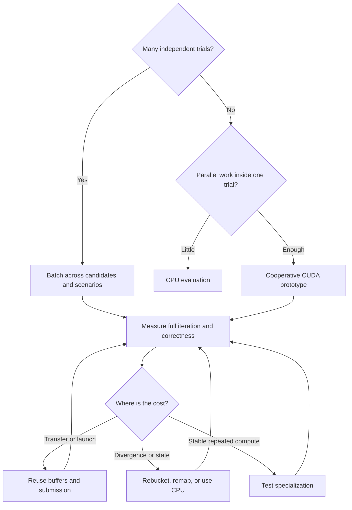

Initially keep proposal generation and archive admission on the CPU. GPU population mutation or selection is worthwhile only if its cost matters. CUDA can accelerate fitness, descriptors, distance calculations, and sensitivity sweeps without moving the entire search controller. Preserve exploration outside surrogate-preferred regions, and reserve held-out workloads to detect overfitting.

Novel primitives need explicit semantics and justified costs. The optimizer must not win by assigning a one-cycle cost to an arbitrarily powerful new instruction. Record uncertainty ranges and test whether architectural rankings survive them. Physical synthesis and calibrated models eventually constrain those ranges.

### 8.10 A focused CUDA experiment portfolio

| ID | Controlled experiment | Measurements and falsification condition |
|---|---|---|
| C01 | Same bounded machine on scalar CPU, parallel CPU, thread/warp/block CUDA. | Full logical agreement; batch-size crossover; valid trials per second. Any semantic mismatch blocks promotion. |
| C02 | Generic GPU interpreter versus NVRTC variants across edit rates and program sizes. | Accepted quantity at fixed quality, quality at fixed budget, edit latency, compile/checking waste, and cache growth. Specialization loses when reuse does not repay its costs. |
| C03 | CPU and CUDA enumeration over a small complete domain of programs and inputs. | Identical counterexample sets and explicit coverage bounds. Minimize a mismatch into a regression case. |
| C04 | Many object-layout, scheduling, and migration policies over shared edit traces. | Modeled work, queue pressure, state retained, and edit-to-effect distributions. Replay survivors independently. |
| C05 | Fabric/routing candidates under multiple calibrated cost scenarios. | Robust Pareto frontier and rank changes. A winner dependent on optimistic unmeasured costs remains conditional. |
| C06 | Random, local, evolutionary, and quality-diversity search with the same evaluator. | Validated discovery quality at equal total wall/compute budgets, including failed candidates and training costs. |
| C07 | Direct parameter search versus differentiable relaxation. | Exact discrete quality after projection, gradient-check failures, and total search cost. A low relaxed loss alone does not pass. |
| C08 | Recorded workload from a QEMU guest evaluated by native CUDA models. | Trace-contract agreement and co-simulation overhead. GPU batch results must retain their modeled evidence label. |
| C09 | Live physics/image/signal construction workload with parameter, operation, and topology edits. | Accepted session quantity, result quality/coverage, interaction latency, inspection, state preservation, recovery, and human effort. |
| C10 | Isolated discovery versus concurrent UI kernels and optional model inference. | Contention, cancellation delay, memory pressure, and user responsiveness. Controlled comparisons use isolated timing first. |

Implement C01–C03 first, then select two additional tracks based on findings. This is a staged portfolio, not a requirement to build ten engines before learning anything.

### 8.11 Containers, QEMU, and CUDA cooperate through a contract

Run QEMU and the native CUDA worker in the same admitted container or in separate containers connected through the harness. QEMU supplies guest execution and instrumentation. CUDA supplies batches of explicit models or a deliberately offloaded numerical/device component. QEMU documents TCG and platform virtualization accelerators; ordinary QEMU execution does not automatically move to CUDA [35][ref-35].

The first integration should export immutable guest traces, evaluate them in batches, and replay selected outcomes in the guest implementation. Separate exogenous stimuli from decisions made by the original guest policy. Replaying old scheduling or allocation decisions unchanged can remove the feedback a new architecture is meant to explore; let the candidate recompute those decisions or use closed-loop co-simulation. Interactive co-simulation comes later: define request IDs, logical timestamps, input/output formats, synchronization, and failure behavior. Measure round-trip costs. Host-container GPU access does not imply CUDA access inside an emulated guest.

### 8.12 Relevant precedents and the specific lesson to borrow

| Project | Established mechanism | Use in this programme |
|---|---|---|
| NVIDIA Warp [86][ref-86] | Python functions compiled into CPU/GPU kernels; differentiable simulation, geometry, and physics tools. | Prototype continuous models and constructionist workloads; investigate gradients. Keep an independently written reference for critical semantics. |
| GATSPI [87][ref-87] | GPU gate-level simulation for switching/power analysis. | Study representation and waveform parallelism for hardware experiments. Switching activity needs an appropriate model to become a power estimate. |
| GL0AM [88][ref-88] | GPU gate-level logic simulator with graph partitioning and waveform processing. | Study how partitioning and data layout make a seemingly irregular problem tractable. Check artifact/dependency availability before adopting its pipeline. |
| SPADES [89][ref-89] | Parallel discrete-event simulation with optimistic rollback and a conservative synchronization alternative. | Compare event synchronization strategies after independent-trial batching works. Rollback and causality costs belong in the experiment. |
| CCCL [94][ref-94], [95][ref-95] | GPU parallel primitives and explicit determinism requirements for supported operations. | Reuse basic building blocks while keeping numerical and ordering contracts explicit. |

These precedents demonstrate mechanisms worth studying. Their published speedups, hardware configurations, and supported semantics do not predict performance on this laboratory. The wider language, synthesis, and hardware atlas in sections 4–5 and 23 remains relevant; CUDA provides another way to test combinations from it.

### 8.13 Admission, instrumentation, and completion gates

If the existing environment already has working PyTorch, this small test checks calculation and readback in WSL and then in the candidate container. PyTorch is merely a convenient existing dependency here; no transformer is involved. For a devel image without it, use the equivalent CUDA C++ vector calculation rather than installing an unverified wheel.

```python
import platform
import torch
print("machine", platform.machine())
print("torch", torch.__version__, "CUDA", torch.version.cuda)
assert torch.cuda.is_available()
print("device", torch.cuda.get_device_name(0))
print("capability", torch.cuda.get_device_capability(0))
x = torch.arange(4096, device="cuda", dtype=torch.float32)
y = x * 2 + 1
torch.cuda.synchronize()
expected = torch.arange(4096, dtype=torch.float32) * 2 + 1
assert torch.equal(y.cpu(), expected)
print("CUDA calculation and readback passed")
```

This smoke test does not establish support for NVRTC, graphs, profiling, managed memory, or every numerical operation. Admit each feature actually used. Preserve the working WSL driver path and account for documented WSL feature limits [22][ref-22].

| Gate | Required evidence |
|---|---|
| CG0 — Checked device execution | Platform manifest, actual calculation/readback, pinned image and tools. |
| CG1 — Faithful tiny evaluator | Independent primitive tests, hand-checked traces, defined resource exhaustion, repeatable logical results. |
| CG2 — Useful batch engine | CPU/CUDA comparison across sizes and launch mappings, memory accounting, cancellation, and measured crossover. |
| CG3 — Trustworthy search | Replayed finalists, held-out workloads, preserved counterexamples, uncertainty sweeps, total budget accounting. |
| CG4 — Justified specialization | Whole-session benefit including compile/load/validation/invalidation; generic fallback remains usable. |
| CG5 — Stronger architectural evidence | Selected native, QEMU, detailed simulation, or RTL results with explicit model-to-implementation mapping. |

Use supported Compute Sanitizer checks for memory, initialization, synchronization, and shared-memory hazards [96][ref-96]. Use Nsight Systems where available to inspect launches, transfers, and synchronization [97][ref-97]. Probe actual tool support on the local platform; retain unprofiled timing trials because instrumentation changes execution.

Record host wall time, device intervals, transfer volume, preparation, compilation, validation, and archive costs separately. Serialize final GPU timing comparisons, separate cold start from warm execution, and record interference and available telemetry. A missing power counter is missing evidence, not zero energy. Report research throughput and validated discovery quality alongside candidate performance.

The first deliverable is a tiny exact machine, two independent evaluators, and a replayable batch report. It makes CUDA useful to discovering the blob before committing to its final language, VM, or hardware.


## 9. Simulation and emulation evidence

| Method | What it can establish | What it cannot establish alone |
| --- | --- | --- |
| Native CPU or CUDA run | Correctness and performance of this implementation on this host. | Performance of a hypothetical processor or fabric. |
| QEMU functional emulation | Boot behavior, instruction semantics, device protocol behavior. | Cycle accurate processor performance; QEMU explicitly excludes this interpretation [29][ref-29]. |
| Discrete event simulation | Policy behavior and modeled queues, stalls, traffic, and reconfiguration costs. | Physical timing or energy without calibrated assumptions. |
| gem5 model | Processor and memory behavior under a named CPU/cache/interconnect model [30][ref-30]. | A faithful N1X model merely because it runs on the N1X. |
| RTL simulation | Logic behavior and cycle counts for the implemented synchronous model. | Clock frequency, physical power, area, or routed timing. |
| Synthesis and implementation | Target-specific resource and timing estimates for supported tools and devices. | Silicon behavior under all conditions or automatic validity of simulated transitions. |

### Fidelity ladder

Use the cheapest model that can falsify the current hypothesis. Begin with an independent CPU reference. Section 8 defines CUDA evaluation across candidates, tests, and scenarios, plus cooperative simulation where appropriate. Retain CPU routing when measured GPU overhead dominates. Use a more detailed processor model for memory and instruction questions; use RTL for proposed hardware primitives. Promote only a small, diverse set of surviving designs.

Record two times: how long the simulator took on the N1X, and how long the simulated machine is predicted to take. Report simulated cycles together with the assumed clock and cost model. Never use simulator speed as predicted device speed.

Calibrate known baselines before searching novel designs. Compare CPU and CUDA versions of the same simulator, run independent small hand-checked cases, and perturb memory, interconnect, and replacement costs. If a candidate wins only under one optimistic assumption, retain it as a conditional hypothesis.

Do not depend on nested KVM. Probe availability only if needed; QEMU TCG is the functional fallback. Keep CUDA passthrough to a nested guest outside the initial plan. Build native ARM64 host tools where supported and record unavailable packages as compatibility findings.

## 10. Benchmarks that include change

Each workload has stable, gradual-edit, burst-edit, and repeated-invalidation traces. Include both fixed wall-clock arrivals for responsiveness and fixed logical-work edit positions for semantic comparison. Record backlog and dropped work so a slow candidate cannot benefit by processing fewer events.

| Workload | Edits to replay | Main observations |
| --- | --- | --- |
| Live scene | Move objects; change behavior; clone or delete; inspect during animation. | Completed construction tasks; behavior/fidelity requirements; visible latency, frame stalls, identity, and inspection. |
| Stateful filter | Change coefficients, replace an operation, expand history state. | Accepted samples at declared error and freshness limits; migration correctness, continuity, and update wait. |
| Actor pipeline | Change handler and message schema; restart a worker. | Distinct valid deliveries, completeness, and deadlines; queue mapping, losses/duplicates, isolation, and recovery. |
| Numerical graph | Fuse or split operators; change shape or precision. | Accepted results at declared accuracy; quality at fixed budget, end-to-end throughput, and compilation waste. |
| Irregular graph | Change adjacency and object layout; alternate access patterns. | Correct query/update completions and coverage; dispatch/memory cost, invalidation scope, and preserved state. |
| Mixed interactive task | Combine UI deadlines, background search, numerical work and edits. | Per-task quantity and quality, responsiveness, task success, intervention, and contention. |

### Trace contract

```yaml
trace_id: filter_burst_v1
semantic_contract: stream_v1
seed: 17
arrival_mode: wall_clock
events:
  - {at_ms: 0, action: start, input: recorded_samples}
  - {at_ms: 1000, action: set_parameter, version: v2}
  - {at_ms: 1800, action: replace_operation, version: v3}
  - {at_ms: 2500, action: migrate_state, version: v4}
  - {at_ms: 3000, action: inspect, expected: state_predicate_4}
```

This is a proposed schema. The actual trace must include definitions or immutable hashes, full inputs, migration code, expected outcomes, and effect ordering. A seed alone does not capture external inputs. Split training, validation, and final held-out sets by scenario family as well as seed to reduce leakage.

Use exact checks for discrete operations and an explicit numerical tolerance or task-quality contract for approximate results. Keep exact and approximate candidates in distinct comparison groups unless their accuracy requirement is identical. Define coverage, freshness, permitted version overlap, and the treatment of missing/late results. Section 11 specifies quantity-at-quality and quality-at-budget comparisons; neither may hide difficult unfinished work.

## 11. Measurement and acceptance procedure

Measure the quantity and quality of useful results produced over the entire editing session, together with responsiveness, inspectability, and state continuity. Include compilation, waiting, migration, failed or discarded work, recovery, and human intervention in the session's costs. Keep the outcome dimensions separate so a faster result cannot hide an unacceptable quality loss.

### Declare what counts as useful work

Before a comparison, freeze the semantic contract, work unit, result-quality criteria, editing requirements, resource envelope, trace set, and acceptance rule. Correctness and deterministic replay are hard requirements where the contract demands them. Approximation, freshness, state-loss allowances, and quality thresholds must be explicit and identical for comparable candidates.

| Dimension | Operational definition | Required companion observations |
| --- | --- | --- |
| Useful quantity | Count of distinct application work units completed within the session that satisfy the declared semantics, quality, version, and delivery requirements. Report the count and count divided by full session wall time. | Offered workload, coverage, backlog, missing, late, duplicate, invalid, cancelled, and discarded results. Count each accepted unit once. |
| Result quality | Workload-specific accuracy, fidelity, completeness, robustness, and freshness of delivered results. Use the declared reference or scoring rubric. | Distribution and worst cases where meaningful; quality during interaction as well as at the end. Report completed-only scores alongside the predefined treatment of missing results. |
| Editing experience | Edit-to-first-valid-effect latency, pauses, unrelated UI stalls, inspection fidelity, preserved state, recovery success, and intervention effort. | Failed edits, lost work, task completion success, observation counts, and uncertainty. An acknowledgement is not evidence that the change took effect. |
| Assurance | Evidence that the stated requirements hold: tests, bounded exhaustive checks, and scoped proofs with recorded assumptions and implementation coverage. | What was checked, what remains outside the claim, and evidence-generation/checking cost. Proof quantity is not a product-quality metric. |
| Costs and resources | Compile, load, validate, drain, migrate, warm up, recover, and discard costs; memory, code/cache growth, compute, and energy where measurable. | Cold/reused conditions and human active time. Do not add overlapping activity durations to wall time a second time. |

Stale results count only if the contract permits their version and age. Failed and inconclusive trials remain useful research evidence but do not become successful application work. For heterogeneous tasks, report per-class counts or a preregistered domain utility; do not silently add frames, messages, and tasks into one number.

Keep three levels distinct: **evaluator throughput** is valid trials per second; **discovery productivity** is useful validated findings or counterexamples within a research budget; **application productivity** is accepted user work during the editing session. A faster evaluator need not produce better discoveries or a better live environment.

### Compare both quantity and quality

| Comparison | Hold fixed | Compare and report |
| --- | --- | --- |
| Quantity at specified quality | Workload and edits, quality threshold, required assurance, editing-experience limits, session duration, and resource envelope. | Accepted work count/rate, coverage, quality distribution, failures, and editing metrics. |
| Quality at fixed budget | Full task set or arrival stream, edit demands, time/compute/memory budget, required assurance, and minimum delivery/interaction requirements. | Result quality together with completed quantity, coverage, and editing metrics. Apply a predefined policy to missing, late, or invalid results. |

Neither mode permits a candidate to appear superior by completing only easy tasks. Preserve all offered work in the report. Keep fixed wall-clock edit/arrival traces for responsiveness and fixed logical-work edit positions for semantic comparisons; report these protocols separately.

For scripted comparisons, define the session's start and stop events before running it. Count all compilation, checking, waiting, migration, and recovery that falls inside that window. Report setup and prior search/precompilation costs separately when outside it; disclose any amortization rule. Stop accepting results at the declared boundary and retain unfinished work as backlog. Record human intervention separately from automated trace costs.

### Initial laboratory targets

For the small interactive demonstrator, start with p95 edit-to-effect under 100 ms for compatible changes and p99 unrelated UI stalls under 50 ms. These are proposed budgets, not established limits or product promises. Measure the existing baseline first and retain an absolute user-facing budget even when reporting relative improvements. Schema changes and machine replacement have separately declared budgets. Add workload-specific quality and state-continuity requirements before using these latency targets as an acceptance gate.

### Run procedure

1. Save the environment and objective manifests; build from pinned inputs. Specify quality, coverage, assurance, interaction, and missing-result rules before seeing results.
2. Validate semantics and state invariants on small deterministic and generated cases; check required proofs when the experiment calls for them.
3. Run cold-start and reused scenarios separately, including declared transition and validation costs.
4. Interleave candidate order and repeat complete traces with multiple seeds. Give candidates the same workload and optimization opportunity, including failed attempts and search overhead.
5. Collect quantity, quality, coverage, editing experience, and costs together. Report paired differences and uncertainty rather than a single speed number.
6. Investigate invalid, stale, missing, late, and discarded results before summarizing any gain.
7. Re-run finalists on untouched scenario families and cost perturbations. Check quality and interaction regressions as well as throughput. Separate routine selection cases from final confirmation cases and record access to confirmation results. Once those results influence new proposals, the exposed cases become development evidence for that search; require a new untouched suite for a further generalization claim.
8. Record the tradeoff, proof/test scope, assumptions, and evidence that would reverse the decision.

Start with five complete repetitions per candidate and expand when variance could change the decision. Tail estimates require enough individual events; if sample counts are insufficient, report the counts and observed distribution without a confident p99 claim. Use run-level or block resampling rather than pretending correlated events are independent.

Scripted traces establish controlled implementation comparisons. To evaluate construction and understanding, add small paired human tasks: counterbalance system order, account for learning, and record completion success, errors, lost work, intervention, and effort. Automated traces alone do not establish how well people can explore an unfamiliar system.

### Acceptance and tradeoff decisions

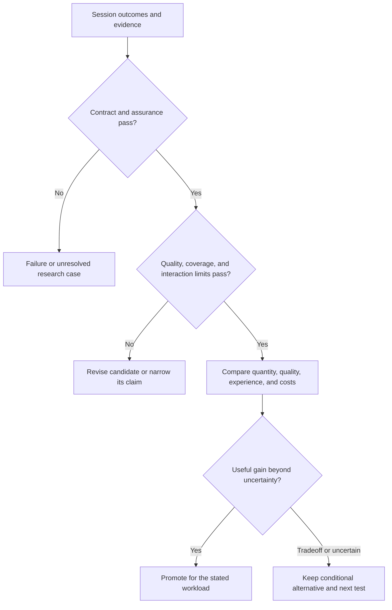

A candidate advances only when it meets its declared semantic, assurance, quality, coverage, and interaction requirements. Any claimed benefit must exceed measurement uncertainty and a preregistered practical margin for that metric. A 10 percent throughput gain can be a pilot hypothesis; it cannot compensate for broken replay, invalid migration, or an unacceptable quality or responsiveness regression.

Keep the Pareto frontier over the relevant outcomes and costs. Select among tradeoffs using stated workload priorities and tolerated regressions. If a domain-specific utility score is useful, publish its weights and sensitivity analysis alongside the separate measurements. Preserve valid but currently dominated mechanisms for the broader discovery archive described in section 22.


### Lean as targeted correctness assurance

Use the Lean theorem prover as an optional specification and proof-checking component. It can strengthen assurance that a mechanism satisfies precise requirements. Empirical result quality, human usefulness, and measured performance remain separate outcomes. Lean checks a formal statement relative to its definitions and assumptions; reviewing whether that statement expresses the intended requirement is still essential [98][ref-98].

Start with a small deterministic transition model, explicit external inputs, versioned state, and observable results. The following are proposed proof obligations, not claims already proved by this plan:

| Property | Proposed claim | Boundary to state explicitly |
| --- | --- | --- |
| Replay determinism | The same initial logical state and recorded inputs yield the same observations. | Input ordering, oracle responses, numeric rules, and modeled effects. |
| State migration | A permitted migration preserves required invariants and retained logical information. | Preconditions, allocation failure, and specified initialization of newly added fields. |
| Update atomicity and recovery | Observers see an allowed version; a rejected update preserves the prior committed state. | Observation boundaries and external effects that cannot be rolled back. |
| Local optimization | A rewrite or specialized model preserves required observations under explicit guards. | Overflow, aliasing, floating point, effects, and the validity of guards. |
| Representation change | Different layouts correspond to the same abstract state through a stated relation. | Serialization, identifiers, memory behavior, and implementation coverage. |

A first pilot should cover the streaming filter's state invariant, one history-buffer expansion, and rejection of an invalid migration. Prove preservation of samples that were actually retained; do not imply that increasing the buffer reconstructs unavailable history. Then measure proof-authoring, checking, and maintenance effort against defects found and reuse across edits.

Keep the connection to execution explicit. A proof about the transition model does not establish that a separately written CUDA kernel implements it. Differential testing provides conformance evidence; a proved refinement can establish a stronger correspondence for its stated implementation model and assumptions. Compiling Lean code or calling foreign code introduces additional runtime/compiler trust and does not automatically prove the machine-code behavior [101][ref-101], [102][ref-102]. Label the resulting claim accurately: **tested against a proved model** until the relevant implementation correspondence is also established.

For optimized Lean functions, `@[implemented_by]` replaces runtime code without checking equivalence. Lean documents `@[csimp]` as an alternative requiring equality evidence for supported safe replacements. This is a useful precedent for admitting specialized implementations with proofs, not a turnkey verifier for arbitrary CPU/CUDA code [100][ref-100].

Use the following procedure when an experiment requires Lean assurance:

1. Freeze the intended statement, definitions, and permitted assumptions before judging a candidate. A transformer may propose a proof; it may not silently weaken the requirement it is meant to satisfy.
2. Pin the Lean toolchain and dependencies. Record theorem, model, candidate, proof, and checker identities together.
3. Build and check proofs, audit transitive dependencies with `#print axioms`, and exclude `sorryAx` from completed assurance claims. Record permitted logical axioms, custom assumptions, and native-evaluation dependencies [99][ref-99].
4. Distinguish proof checking from native execution: `native_decide` depends on compiled computation and expands the trusted components beyond ordinary kernel checking [99][ref-99]. Use appropriate proof replay or independent checking for promoted claims [98][ref-98].
5. Record whether the claim is conjectured, tested, proved within a model, or connected to an implementation through a proved refinement. Keep the tested domain and remaining trust boundary visible.
6. Recheck affected obligations when semantics, guards, migrations, or dependencies change. Prefer parameterized theorems that cover a family of edits: prove the rule once and check its explicit preconditions for each covered edit. Reuse proofs only when their assumptions still apply; account for cache invalidation and checking costs.

Preserve live interaction while this work proceeds. Let an already admitted implementation continue while a proposed replacement is checked. When the admission policy requires a proof, publish the replacement only after that proof and its other checks pass. Exploratory branches can retain unproved ideas with explicit status; a failed or unfinished proof is not evidence of a false theorem or a completed assurance claim.

Lean can also establish formal numerical error or resource bounds when the relevant mathematics and cost model are supplied. Those bounds do not measure actual GPU latency, human comprehension, or whether the specification chose the right behavior. Keep the quality/quantity comparisons above, add the assurance required for each comparison, and measure whether stronger assurance earns its authoring and runtime-checking costs.


### Rocq/Coq and choosing a proof ecosystem

Coq, now named the Rocq Prover, is also a strong candidate for the blob's assurance work [103][ref-103]. Lean and Rocq overlap in specification, theorem proving, and program verification. Select them by the proof obligations and reusable developments needed for an experiment, rather than assigning one exclusively to mathematics and the other to systems.

For the blob's VM, concurrency, compiler, and hardware questions, the following Rocq/Coq projects provide concrete starting points. The applications in the last column are proposed experiments, not properties these projects automatically establish for the blob.

| Project | Existing mechanism | Proposed use and boundary |
| --- | --- | --- |
| CompCert [104][ref-104] | Verified compilation from a defined C representation to assembly semantics on supported targets. | Preserve proved behavior of a small C runtime component through covered compilation passes. It does not prove that the C program meets the desired specification; its documented theorem boundary excludes parts such as preprocessing and final assembly/linking. It is not a CUDA compiler. |
| Verified Software Toolchain / Verifiable C [105][ref-105] | Separation-logic reasoning about C, with soundness relative to CompCert C semantics. | Prove a concrete snapshot, bounded queue, or state-migration routine obeys its memory and functional contract. Model allocation/failure and external calls explicitly. |
| Iris [106][ref-106] | A framework for concurrent program reasoning, type systems, and data abstraction, implemented and verified in Rocq. | Investigate ownership, atomic update boundaries, concurrent access to old/new versions, and resource reclamation. An appropriate language and memory model must connect the logic to the implementation. |
| Kami [107][ref-107] | Parametric hardware specification and modular verification in Coq, with an extraction path toward circuits. | Prove a small processing element or configuration-commit controller refines an abstract machine. Physical timing, synthesis correctness, device behavior, and safe reconfiguration remain explicit boundaries. |
| bedrock2 [108][ref-108] | A low-level programming and verification development with compilation to RISC-V and connections between software and hardware specifications. | Explore a small VM primitive or monitor with a narrower implementation-to-model gap. RISC-V may be an emulated target in this laboratory; adopting it does not change the host ISA or verify QEMU itself. |

These are ecosystem advantages to investigate, not exclusive capabilities of Rocq. For example, the Iris project also links a Lean port [106][ref-106]. Assess the exact libraries and proof features needed for the pilot, their supported versions, and how much work can actually be reused.

**Suggested selection experiment:** specify one bounded snapshot-and-patch operation and its rejection behavior. First write the invariant, observable result, and assumptions in plain language. If choosing the prover for the abstract core is still an open question, prove that same obligation in Lean and Rocq using a small capped effort. Record specification clarity, proof effort, automation reliability, rechecking cost, and the proof changes required by an added state field. Test cases can reveal differences between the two specifications, but agreement on those cases is not a proof that their formal meanings coincide.

If a concrete C implementation is the main next step, investigate VST with CompCert. If concurrent state ownership dominates, investigate Iris. If the uncertainty concerns a modeled hardware controller, investigate Kami. Select one primary prover per component so proof maintenance stays manageable; add another only when a reusable development or independent assurance benefit warrants the integration.

Proof artifacts are not automatically interchangeable between Lean and Rocq. Sharing serialized inputs, outputs, and tests is useful engineering, but combining formal guarantees requires a stated semantic correspondence and a justified translation or checking boundary. Otherwise report the two claims separately. Native extraction, foreign calls, and separate compilers also retain their declared trust assumptions.

For CUDA, either prover can host an explicit model of operations, synchronization, and memory behavior. Neither cited ecosystem gives this project automatic verification of arbitrary CUDA kernels, NVIDIA drivers, or GPU hardware. Continue GPU counterexample search and independent reference checks while investigating proof coverage for selected primitives. A proved abstract deterministic schedule does not by itself establish that a parallel implementation is race-free.

A nondeterministic oracle can propose candidates and proof attempts in either ecosystem. Freeze the requested theorem and assumptions, then check the proof independently under the admitted policy. Keep admitted runtime code active while checking replacements, reuse parameterized theorems when their preconditions hold, and include proof costs in the full-session comparison. Rocq therefore contributes to the same assurance dimension as Lean; empirical output quality, quantity, and human editing outcomes still determine whether the resulting blob is useful.


## 12. Wisdom tree for live replacement

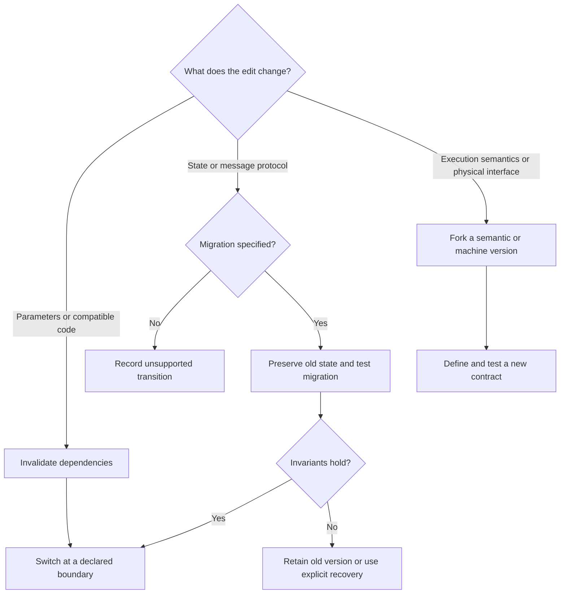

*Figure 2. Choose update semantics before choosing an implementation. Each leaf becomes an evidence-bearing decision record.*

W1 asks what the user expects an edit to do to already running work. Future-call semantics is the first baseline because it is easy to state and test. More ambitious behavior must earn its complexity.

| Node | Evidence required | If evidence fails |
| --- | --- | --- |
| W1A Compatible edit | Every result has the correct version; dependency invalidation is complete. Compare with Self [1][ref-1], [2][ref-2]. | Reduce the optimized region or restore the general execution path. |
| W1B State migration | Declared invariants hold across generated states; queued work has a defined interpretation. Compare with OTP and Ginseng [7][ref-7], [8][ref-8]. | Keep the old version, reject the transition, or explicitly restart that region. |
| W1C New semantics | A new contract and reference evaluator distinguish intentional behavior changes from optimization bugs. | Do not count incompatible outcomes as a speedup. |
| W1D Active frame edit | Reconstruction maps produce correct logical state at supported boundaries. | Use bounded chunks or call-boundary replacement. |

Record the supported change class as part of every performance result. A system that only updates constants cannot be compared as equally reprogrammable with one that migrates state layouts. Keep the recovery operation inspectable and test failure during each transition stage.

## 13. Wisdom tree for specialization

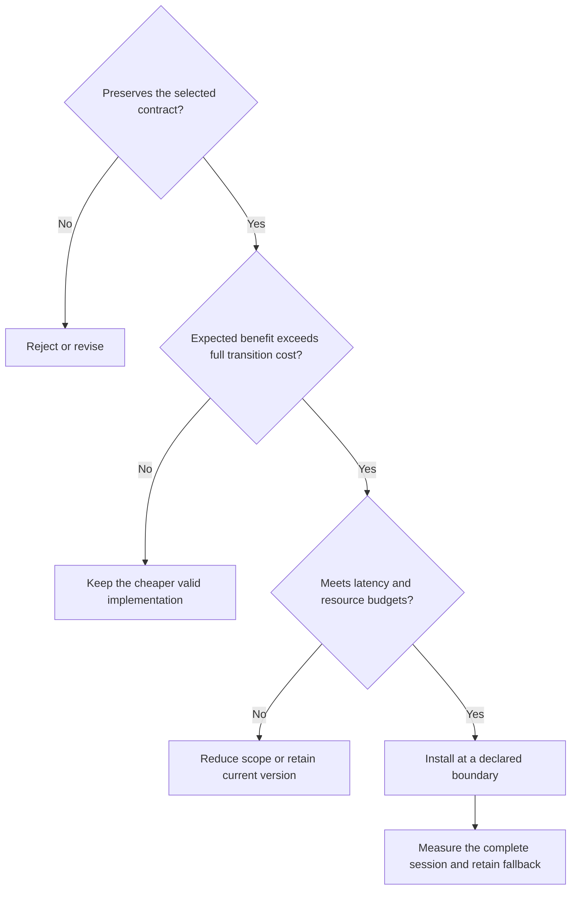

*Figure 3. Specialize when expected useful work justifies the complete transition cost. If latency or resource budgets fail, reduce scope or retain the current implementation.*

W2 considers execution frequency, expected time until the next invalidating edit, available capacity, and the cost of switching. The fast controller should use a simple measured rule before adding learned predictions.

### Decision procedure

- Estimate remaining stable work from observed edit intervals and workload structure. Retain uncertainty and handle bursty changes.

- Measure the candidate end to end, including transfer, launch, dependency tracking, inspection metadata, and first-use effects.

- Select a candidate only when expected savings outweigh compilation and transition costs under the chosen resource budget. Keep resource-time and user latency as separate measures rather than adding incompatible units.

- Require a minimum residence interval or confidence margin to prevent repeated switching. Cancellation must also have a cost and a defined outcome.

### Useful pivots

If GPU transfer or launch dominates, retain data, fuse work, increase useful batch size within latency limits, or return that region to the CPU. If invalidation dominates, specialize a smaller region or use weaker assumptions. If migration dominates, test explicit state boundaries or multiple compatible versions. If search competes with UI work, cap its resource use.

NVRTC and CUDA Graphs provide practical mechanisms for measuring these tradeoffs on the existing GPU [27][ref-27], [28][ref-28]. Coarse reconfigurable overlays provide a hardware analogy [13][ref-13]. Neither establishes that all graph or state changes can be applied to active work immediately.

## 14. Wisdom tree for choosing a search method

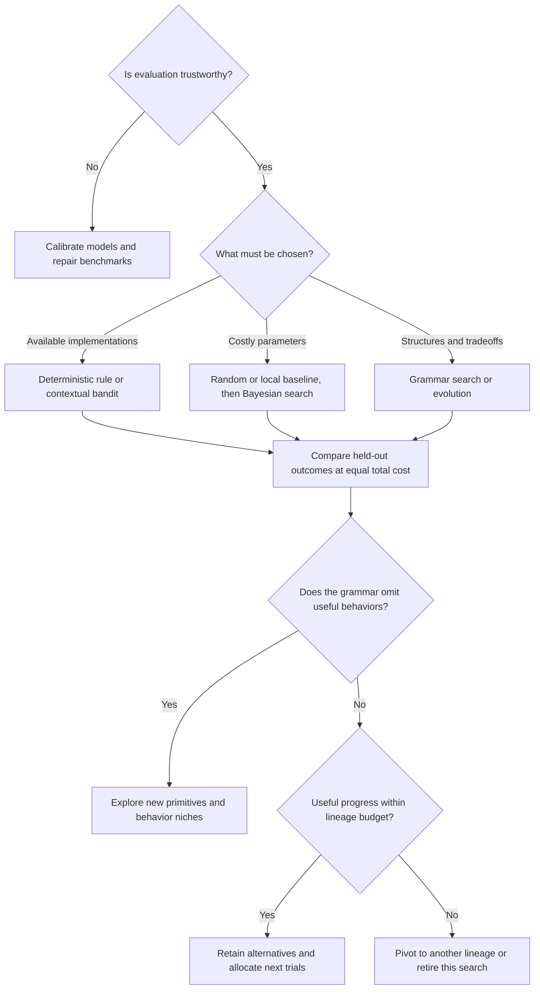

*Figure 4. The optimizer is chosen after the evaluation is trustworthy. More complex search must beat simple controls under equal total budgets.*

W3 first checks whether the objective measures the live experience and whether lower-fidelity rankings transfer. Repair either problem before spending a larger search budget. Retain a Pareto set of alternatives rather than hiding incompatible goals behind one arbitrary score.

| Situation | First policy to test | Promotion test |
| --- | --- | --- |
| Select an available version | Deterministic rule, then contextual bandit. | Lower session cost without additional deadline misses. |
| Tune costly parameters | Random/local baseline, then Bayesian search. | Better held-out results per total evaluation cost. |
| Search discrete structures | Grammar-constrained evolutionary search, optionally NSGA II [19][ref-19]. | A stronger feasible frontier than random/local search. |
| Use shorter evaluations | Multi-fidelity search such as BOHB [18][ref-18]. | Short-run rankings predict complete edit sessions. |
| Search broad schedules | Learned cost model plus candidate search, as in Ansor [17][ref-17]. | Screening errors and tuning cost do not erase gains. |

Begin with correctness, edit-latency and memory as constraints; optimize session completion time and resource cost. Add objectives only when they change decisions. Preserve rejected candidates and their failure reasons to keep search from repeatedly rediscovering invalid designs.

Periodically evaluate the search policy itself against random search, simple local search, and selected manual alternatives at matched total cost. Report useful validated findings, transfers, counterexamples, and resolved uncertainties separately. A small improvement in the current winner does not justify consuming the portfolio's reserved exploration budget.

## 15. Evolutionary architecture search procedure

The first genome should describe implementation and policy choices under fixed semantics. Do not evolve arbitrary source strings or silently change required behavior. A separate research track may propose new semantics, each with its own specification and benchmark expectations.

| Genome group | Initial bounded choices |
| --- | --- |
| Execution region | Operator, basic block, actor turn, or bounded graph segment. |
| Representation | Tagged values, typed specialized values, object handles, or explicit state records. |
| Dispatch and assumptions | Indirect table, inline cache, guarded direct call; local or transitive invalidation. |
| Memory and mapping | Local state versus shared buffers; placement on CPU, CUDA, or a modeled fabric. |
| Virtual hardware | Processing element capability, routing topology, queue depth, scratchpad size, transfer boundary. |
| Policy | Specialization trigger, stability predictor, cache budget, cooldown, and search allocation. |

### Candidate lifecycle

Generate a well-formed candidate from a typed grammar. Reject invalid interfaces and resource violations cheaply. Run differential correctness tests and any required proof checks. Freeze quality, coverage, and editing-experience requirements before comparing fitness; retain separate outcome dimensions as specified in section 11. Evaluate short traces only after their rankings have been validated. Fully evaluate survivors, retain nondominated alternatives, and test finalists on held-out traces and perturbed hardware costs. Keep each artifact and decision linked to its source genome.

For an initial policy comparison, allocate 30, 100, and 300 candidate evaluations to random, local, Bayesian, and evolutionary methods, with five seeds where affordable. Also cap elapsed time, CPU/GPU time, memory, storage, and any model-service spending. Use the same corpus and account for failed builds, proposal generation, checking, and surrogate training. These are adjustable pilot budgets; expensive RTL evaluations receive a smaller, explicitly declared allocation. Trial count alone is not an equal-cost comparison, and the earliest hard limit ends further admission.

### Bounded autonomous campaigns

Autoresearch supplies a compact precedent: a narrow editable implementation, fixed evaluation, baseline-first trials, and a written agent procedure [109][ref-109], [110][ref-110]. Its training budget excludes startup and compilation. Blob must retain the full editing-session accounting in section 11, with prior preparation and research costs separately visible. This is an adaptation to test, not evidence that autonomous search already improves Blob.

Define a campaign with a current `program.md` and a machine-readable experiment definition. Freeze their identities with the baseline, allowed edits, semantic contract, grammar, reference, evaluator, workload splits, numerical rules, and acceptance criteria. The [repository template](../../experiments/_template/program.md) is a draft specification; no runner or enforcement system is implemented yet. Frozen instructions remain part of historical evidence when the current procedure changes.

The proposed loop is: establish the baseline; select a candidate and hypothesis from the allocated portfolio track; preserve source identity; run cheap conformance checks; screen eligible candidates; repeat promising comparisons; confirm finalists independently; record every outcome and cost; then apply budget and stagnation rules before admitting another trial. The laboratory must verify frozen artifacts, constrain writes, and measure results outside candidate-controlled reporting. Written instructions alone do not establish evaluation integrity.

Keep trial outcome separate from promotion. Invalid, crashed, cancelled, interrupted, and inconclusive trials are evidence, not successful work. A temporary performance regression may continue in an isolated branch with a hypothesis, milestone, resource ceiling, and exit condition. It cannot replace the accepted implementation until the full admission requirements pass. This permits multi-step mechanisms, such as state handles that initially add overhead but later reduce migration cost, without relaxing correctness for accepted behavior.

Review each lineage at declared trial and elapsed-time intervals. Meaningful progress requires a practical gain beyond noise, a useful new behavior, a reproducible counterexample, or resolution of a named uncertainty. Persistent stagnation triggers an independent restart, mechanism transfer, representation change, new comparison family, or retirement. New branch names and campaign restarts do not erase lineage costs or renew its allocation. The [research policy](../guides/autonomous-research.md#portfolio-and-stagnation-defaults) owns the pilot intervals and allocation rules; departures must be recorded before a campaign begins. Reserve enough resources for confirmation and evidence persistence, or report a candidate as unconfirmed.

### Protect the search from misleading success

- Keep a deterministic CPU reference independently implemented from the optimized simulator. Do not reuse the same faulty transformation in both.

- Perturb memory, routing and reconfiguration costs; test longer traces and less regular workloads.

- Maintain diverse finalists rather than only the best score from one simulation.

- Pivot or retire an optimizer lineage when its declared review windows produce neither a meaningful gain nor useful new evidence. Preserve temporary regressions only within their explicit exploration allocation; do not repeatedly consume the final confirmation suite to decide routine continuations.

Thompson motivates attention to the evaluation medium [20][ref-20]. Simulation search can discover novel designs and can also exploit omissions in the simulator. Physical implementation remains a later validation stage.

## 16. Staged programme and decision gates

| Stage | Work and deliverable | Gate to continue |
| --- | --- | --- |
| P0 Platform | Inventory; native CPU and CUDA container probes; pinned manifest. | G0 Repeatable checked execution on the selected host stack. |
| P1 Semantics | Reference evaluator; versioned edits; deterministic traces; mock effects. | G1 Repeatable outputs and state, explicit handling of unsupported changes. |
| P2 Live loop | One scene or pipeline UI; compatible edits and one state migration; inspection. | G2 Task quality and state-continuity requirements met; edit budgets and recovery demonstrated. |
| P3 Specialization | Generic execution, fast baseline, background compiled variant; CPU/CUDA crossover. | G3 Whole-session quantity/quality benefit at declared assurance and interaction limits, including checking costs. |
| P4 Virtual machine | Two or three processor/fabric models; explicit state and transfer costs. | G4 Known baselines reproduced and ranking stable under cost sensitivity. |
| P5 Search | Heuristic, random/local, Bayesian and evolutionary comparisons with bounded campaigns and alternative lineages. | G5 Validated held-out improvement at matched budgets; quantity, quality, coverage, and editing experience reported; retention, budget enforcement, and stagnation pivots demonstrated. |
| P6 Co-design | Joint representation, region, mapping and policy search; targeted RTL experiments. | G6 Advantage exceeds model uncertainty and implementation complexity. |
| P7 Physical validation | Select a small FPGA experiment or other suitable hardware target. | A separate implementation proposal with measurable claims and budget. |

The sequence is gated rather than date driven. Do not wait for a complete language, operating system, or custom CPU before reaching P2. An early win is a useful live change with transparent state and predictable performance; an early loss can eliminate an architecture branch.

### First experiment

For the discovery engine, use section 8 experiments C01–C03 and gates CG0–CG2 before scaling the search. The following streaming filter is a complementary experiment on the actual blob execution path; its GPU timings measure a real implementation.

Use a streaming filter with a small visual output. Replay a constant change, a compatible operation replacement, and a history-buffer expansion. Compare a generic CPU implementation, a conventional compiled CPU baseline, a generic CUDA path, and a specialized CUDA kernel. Keep inputs and edits identical. Report accepted samples at fixed error/freshness limits, quality and coverage at fixed session budget, edit latency, state retained, compile/checking waste, and recovery after a deliberately failed migration. Include missing and discarded samples and any human intervention. If Lean or Rocq is piloted, begin with the state invariant and a specified history-buffer migration; keep its proof scope and implementation-conformance evidence explicit.

After this result, decide whether the next bottleneck is language dispatch, state migration, launch/transfer overhead, or policy. That decision determines the next prototype; it is the first entry in the wisdom graph.

Before broad source mutation, pilot the autonomous loop by varying CPU processing batch size under identical recorded edits. Require numerical agreement, state continuity, failed-migration recovery, and the declared edit-latency bound before promotion. Compare simple search with agent proposals under a small explicit budget. Demonstrate replay, cancellation, candidate retention, and budget accounting before expanding editable scope or adopting a more elaborate search framework.

## 17. Experiment records and operating routine

Use the [repository architecture](../architecture.md) as the directory authority: contracts under `contracts/`; implementations under `components/`; shared workloads and traces under `corpus/`; campaign definitions under `experiments/`; decisions under `docs/decisions/`; and small result manifests under `results/`. Keep large payloads in ignored local storage or a durable external archive, with immutable hashes and documented retrieval locations. Follow the [external asset conventions](../../external/README.md) for collected datasets and downloaded or built binaries. Local ignored storage alone is not a durable archive.

### Worktrees and evidence ownership

Use a separate Git worktree for each active lineage that edits source. Start from an explicit baseline commit or deliberately materialize a recorded source snapshot; uncommitted and untracked files from the main checkout are not included automatically. Parameter-only trials can share immutable source with separate configurations. Worktrees isolate working files but share Git objects and host resources. They do not enforce evaluator integrity, cache isolation, or exclusive GPU access.

Keep the controller, frozen evaluator, budget ledger, and evidence store outside candidate worktrees. Share hashed external inputs through explicit read-only paths where practical; isolate mutable build outputs and caches that could influence other trials. Record resource scheduling and contention. Preserve each trial's candidate commit with a durable reference or archive its complete source snapshot, including required dirty or untracked files. A discarded commit hash without a retained reference or source archive is not a retention strategy.

Autoresearch records outcomes locally while resetting unsuccessful code changes [110][ref-110]. Blob should similarly keep the working implementation understandable, but retain rejected candidates and evidence independently of the chosen branch. Store small manifests or archive indexes in version control; bulky logs and binaries can remain external. Candidate outcome, archive membership, and promotion are distinct decisions.

Before removing or reusing a worktree, preserve interrupted outcomes, source identity, manifests, and required artifacts. Inspect dirty and untracked files and remove the worktree without discarding the only copy of evidence. Integrate a validated patch or commit into the accepted implementation and rerun applicable checks there. The [research policy](../guides/autonomous-research.md#worktrees-and-candidate-identity) specifies paths and lifecycle; it is not implemented automation.

### Minimum run record

```yaml
run_id: E003-seed17-r2
campaign_id: E003
campaign_definition_hash: REQUIRED
program_hash: REQUIRED
lineage_id: REQUIRED
parent_candidate_ids: REQUIRED_OR_EMPTY_FOR_BASELINE
question: Does edit-aware specialization beat hotness-only tiering?
contract: stream_v1
source_commit: REQUIRED
source_snapshot_hash: REQUIRED_IF_DIRTY_OR_UNTRACKED_INPUTS
source_retention: REQUIRED_DURABLE_REF_OR_ARCHIVE
workspace_record: REQUIRED_FOR_SOURCE_EDITING_LINEAGE
container_digest: REQUIRED
environment_manifest: env-001.json
trace_hash: REQUIRED
candidate_hash: REQUIRED
evidence_kind: local_measurement
evaluator_hash: REQUIRED
reference_hash: REQUIRED
cost_model_hash: REQUIRED_IF_MODELED
logical_trial_ids: trials.json
numerical_contract: REQUIRED
objective_manifest: objectives.json
comparison_mode: quantity_at_fixed_quality
work_unit: accepted_stream_sample
quality_contract_hash: REQUIRED
editing_contract_hash: REQUIRED
coverage_and_missing_result_policy: REQUIRED
assurance_policy_hash: REQUIRED
proof_manifest: OPTIONAL_IF_NO_PROOFS_REQUIRED
proof_ecosystem: lean_or_rocq_or_other_or_none
timing_scope: end_to_end_including_edits
budget_ledger: REQUIRED_CAMPAIGN_AND_PARENT_ALLOCATION
trial_outcome: REQUIRED_COMPLETED_INVALID_CRASHED_CANCELLED_INTERRUPTED_OR_INCONCLUSIVE
archive_decision: REQUIRED_PROMOTE_RETAIN_OR_RETIRE_WITH_REASON
confirmation_access_record: REQUIRED_OR_NOT_APPLICABLE
artifact_manifest: REQUIRED_HASHES_LOCATIONS_AND_RETENTION
results:
  quantity: quantity.json
  quality: quality.json
  editing_experience: experience.json
  assurance: assurance.json
  costs: costs.json
  events: events.jsonl
```

### Wisdom record

For every decision, save: decision ID and parent question; alternatives; source references; tested workload domain; evidence type; measurements and uncertainty; chosen branch; rejected branches and reasons; unresolved assumptions; and the experiment that would reverse the decision. Store decision edges explicitly so the graph can be rendered later. A decision may have several parents.

### Routine after each experiment

Check semantic failures and required assurance evidence first. Inspect outliers, missing results, quality regressions, and host interference. Compare quantity, quality, coverage, editing experience, and costs over the full session, not only its fastest interval. Update the Pareto set and the relevant wisdom-tree node. Choose the next experiment by uncertainty reduced per expected effort. Freeze a known-good configuration before changing dependencies.

Persist candidate identity and outcome even when a trial is rejected. Missing metrics remain explicitly missing with a reason; do not encode a crash as zero latency or zero error. Apply the declared retention tiers before storage fills, preserving sufficient diagnostics for confirmation and important counterexamples. Record any deletion that limits replay. Keep trial history in the evidence archive; maintain current explanations in guides, decision summaries, and this proposal without appending session logs.

### Exit and pivot rules

If the apparent gain disappears when compilation is counted, reduce specialization scope. If a candidate wins only under one cost model, narrow the claim. If no tested implementation meets the edit budget, examine the semantic contract and representation before adding a more complex optimizer. If the UI makes state or transitions less understandable, simplify the interface before extending the machine.

If a lineage stagnates, apply the declared pivot rule rather than automatically granting more trials. If a hard budget is reached, finish cancellation and evidence persistence within the reserved envelope and stop admission. Continuation requires an explicit allocation under the remaining parent budget; a preauthorized controller policy may make that decision. Resource use survives process restarts, and candidates cannot authorize their own extensions.

The first milestone report should contain the platform manifest, reference contract, trace definitions, paired measurements, one live demonstration, three updated wisdom-tree nodes, and a clear next decision. It should identify what remains hypothetical and what was actually observed.

## 18. Transformer models in the blob

The general CUDA discovery engine in section 8 works without a transformer. A transformer may propose experiments or provide a learned service; simulation, graph processing, testing, optimization, and real numerical execution remain independently useful GPU workloads.

Use transformer models as nondeterministic oracles that generate proposals and explanations. A deterministic controller parses, evaluates, selects, and applies proposals according to a versioned policy. The model can discover unfamiliar designs; acceptance depends on executable evidence under the declared contract.

| Role | Oracle contribution | Deterministic boundary |
| --- | --- | --- |
| Architecture discovery | Suggest new primitives, region boundaries, state representations, or search grammars. | A typed candidate description, explicit assumptions, and a separately evaluated experiment. |
| Implementation search | Generate or mutate code, kernels, compiler passes, and mapping policies. | Build, contract checks, resource limits, reference comparison, and held-out evaluation. |
| Construction interface | Translate a user intention into edits to live objects and explain alternatives. | A structured change transaction with declared scope and version preconditions. |
| Testing and diagnosis | Propose adversarial traces, invariants, and explanations of a failure. | Independent reference behavior; model-generated tests supplement existing tests. |
| Application behavior | Provide text, design suggestions, or inference results to an application. | The exact result becomes an explicit external event that can be replayed. |

FunSearch pairs language-model proposals with systematic evaluation; AlphaEvolve extends this pattern to broader algorithm discovery [31][ref-31], [32][ref-32]. Borrow that separation without assuming their reported results transfer to this blob. A model can also guide a genetic algorithm by proposing mutations, but it need not replace random variation or local search.

### Experiments for the existing machine

Start with a recorded-response oracle in its own container lane. Replay fixed proposals to verify the controller without consuming GPU resources. Then admit a local model that fits the measured memory budget, or an explicitly selected remote service. Keep the model runner, tokenizer, weights or service identifier, and sampling settings in the manifest.

Compare random mutation, evolutionary mutation, model-only proposals, and model-assisted evolution at equal total evaluation budgets. Report model inference time and cost separately. Test whether model-generated candidates add useful diversity and improve the held-out frontier. Do not score novelty from eloquent explanations; score supported behavior and generalization.

The N1X GPU is shared with CUDA experiments. Pre-generate and record oracle responses for controlled timing trials, then run a separate contention experiment with live inference. This separates architecture performance from interference caused by the assistant. Oracle failure or timeout must have a declared fallback such as retain-current-version.

### Learned workspaces and semantic projections

Anthropic's J-space research identifies internal representations through their potential for verbal report and studies their role in reasoning and reuse across computations. The lens depends on model activations and vocabulary; the paper does not establish a portable, complete application-state representation [111][ref-111]. Use its shared-workspace mechanism as inspiration for a separately evaluated research component, not as evidence that latent coordinates should replace Blob's durable semantic records.

A learned workspace may retrieve related mechanisms, connect hypotheses, or interpret intentions into explicit proposals. Record the model, encoder or lens, configuration, relevant artifact identities, and actual outputs used in decisions. Preserve latent artifacts when the claim requires them; ordinary embeddings do not establish J-space behavior. Changing a model must not silently change the interpretation of old state. Compare English-centered records, explicit semantic state with projections, and state augmented by a learned workspace under X17 before expanding the baseline commitment.

## 19. Determinism and oracle replay

The target guarantee is deterministic logical execution: the same initial state, semantics, committed implementation versions, and ordered external-event log produce the same logical outputs and state. This does not imply identical wall-clock timing. Numerical reproducibility requires its own explicit scope.

For representation replay, preserve the initial checkpoint, committed transitions, required observations, and original interpretation rules. Replay the recorded commands and outcomes rather than translating the English intent again. Read views must identify their source state version; stale edits need version checks and revalidation. Free-form explanations may be lossy or nondeterministic, so distinguish logical replay from byte-identical prose regeneration and preserve exact text when it influenced a decision. A faithful replay of recorded model outputs does not prove that the model's internal reasoning is reproducible.

### Procedure for admitting an oracle response

1. Assign a request ID and freeze the input state version.
2. Record the complete request, context hashes, model identity and settings.
3. Preserve response bytes, source, binaries and context artifacts by content hash.
4. Parse the response into the permitted proposal schema.
5. Evaluate it in an isolated worker against independent contracts.
6. Recheck the base version; reject stale proposals or rebase and revalidate.
7. Record evaluation evidence, acceptance, publication order and policy version.
8. Replay recorded inputs and evidence through the original policy; assert that acceptance matches. Do not call the model again.

A seed is useful provenance but is not a substitute for the stored response. PyTorch explicitly does not guarantee complete reproducibility across releases or platforms, and CPU/GPU results can differ despite identical seeds [33][ref-33]. Separate replay of an existing history from a fresh discovery run that samples new oracle outputs.

### Sources of nondeterminism to account for

| Source | Required treatment |
| --- | --- |
| Actors and parallel evaluations | Use a deterministic logical scheduler where practical. Otherwise record message ordering, publication order, and externally observed completion events. |
| Timers and performance feedback | Record timeout events and measurements consumed by policy. Replaying a decision is distinct from remeasuring its performance. |
| Randomized search | Use explicit independent random streams and a deterministic candidate order, or record the generated candidates and committed choices. |
| CUDA numerics | Use validated deterministic kernels for the strict execution core. Probe supported deterministic modes; unsupported operations fail that contract rather than silently relaxing it. |
| Approximate numeric experiments | Tolerance describes accuracy, not determinism. Values affecting decisions must be reproducible or recorded as external observations. |

The validation policy and reference evaluator are reprogrammable too, but changing them creates a new semantic epoch with a recorded transition. Candidates in one search run cannot rewrite their own fitness function or erase prior evidence. Old epochs remain replayable using their original rules.

Add gate G2D before autonomous proposal application: replay responses, timeouts, rejected candidates and concurrent completions twice; compare state hashes and effects at every commit. Replay effects into a simulator or recorded-effect sink, without repeating network or physical actions. Claim cross-backend determinism only after demonstrating it. Passing tests supports a bounded contract; it does not prove arbitrary code correct.

### Oracle admission and replay sequence

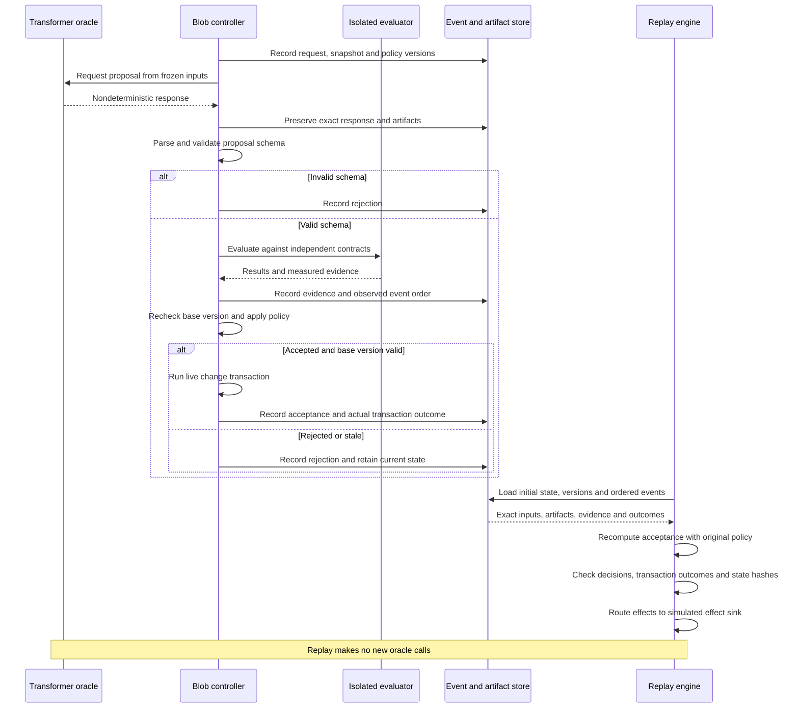

A stale proposal may be rebased only by starting a fresh validation cycle. An accepted proposal can still fail during migration; replay checks its actual transaction outcome. Recorded measurements are policy inputs during replay. Remeasuring performance creates a new experiment.

## 20. Broaden the search before selecting the architecture

The first experiment should stay small. The research space should not. Sections 4 and 5 were a first tranche of precedents; the expanded atlas in section 23 supplies additional mechanisms and competing explanations. None of these catalogues is an exhaustive account of the field, and none defines the permitted boundary of invention.

Treat the blob as a collection of **replaceable semantic commitments**. A commitment might concern object identity, the meaning of time, how effects are handled, how dependencies are tracked, what counts as a transaction, or where instructions reside. Investigate each commitment separately before combining them. A new primitive can enter the search if its semantics and evaluation procedure can be stated clearly.

### Research questions that the initial plan underexplored

| Question | Alternatives to investigate | Evidence that distinguishes them |
| --- | --- | --- |
| How deep does reflection reach? | Object inspection; metaobject protocols; runtime implemented in its own language; reflective interpreter towers. | Which semantic operations can be changed, how state survives, and which bootstrap assumptions remain outside the current experiment. |
| What is the unit of construction? | Objects; expressions with holes; cells; streams; actor turns; dataflow blocks; virtual compute pages. | Useful partial behavior, inspectability, local edit effects, failure scope, and whether users can explain the running state. |
| What representation carries authoritative meaning? | English-centered records; explicit semantic state and projections; semantic state augmented by a learned workspace. | Intent preservation, interpretation errors, replay fidelity, projection traceability, model-replacement cost, and effort to express previously unrepresented concepts. |
| Can change reuse prior work? | Re-execution; memoization; dependency tracking; self-adjusting computation; differential updates. | Repair time and retained memory under localized, widespread, cyclic, and adversarial edits. |
| What makes concurrency deterministic? | Deterministic scheduling; monotone shared data; process networks; logical clocks; explicit effect events. | Repeatable logical outcomes, expressiveness restrictions, buffering requirements, and behavior under timeouts or deadlock. |
| What is an optimization artifact? | Opaque native code; a trace; a transformation script; an equivalence graph; a proof-carrying rewrite; a resident hardware mapping. | Ability to explain, invalidate, reverse, or regenerate it after the source changes. |
| Where does hardware flexibility reside? | Instruction storage; functional units; routing; memory; configuration scheduling; virtualization. | Configuration bandwidth, occupancy, communication, state movement, and modeled execution cost across different workload families. |
| Who may change the system? | Unrestricted image mutation; object capabilities; compartments; explicit authority for edits. | Whether inspection and replacement coexist with failure containment, and whether old references keep unintended authority. |
| How does search escape its own grammar? | Manual new primitives; model proposals; novelty search; quality-diversity archives; coevolving tasks. | New useful behaviors on independent workloads, rather than only better scores within the initial representation. |

### Maintain three connected archives

1. **Mechanism archive:** what a project demonstrates, its assumptions, source, implementation status, licensing constraints if code is reused, and a minimal reproducible example.
2. **Experiment archive:** explicit hypothesis, alternatives, workload, semantic epoch, implementation artifacts, observations, uncertainty, failures, and counterexamples.
3. **Decision archive:** the current conditional choice, its supporting experiments, competing branches, unresolved conflicts, and the result that would reverse it.

A paper is evidence that a mechanism deserves consideration. It becomes evidence for this blob only after the relevant conditions are established. Keep the existing notation: **P** = primary source, **L** = local measurement, **M** = modeled estimate, **H** = hypothesis. Add a separate scope field for functional behavior, host timing, modeled cycles, synthesis estimates, or physical measurements; do not overload one letter with several meanings.

### A procedure for expanding the atlas

For each unresolved decision, follow references backward to earlier mechanisms and forward to subsequent implementations, negative results, and alternatives. Search neighboring communities: programming languages, human-computer interaction, databases, operating systems, formal methods, architecture, reconfigurable computing, and automated discovery. Record the query and selection rationale so the bibliography reflects a deliberate search rather than whichever names were easiest to recall.

Add a project when it changes a hypothesis, reveals a constraint, supplies an implementation technique, or suggests a discriminating experiment. Give a paper-only mechanism a small behavioral reconstruction before attempting to revive an obsolete toolchain. Put a time limit on legacy build recovery; a faithful mechanism experiment may be more useful than reproducing an entire historical environment.

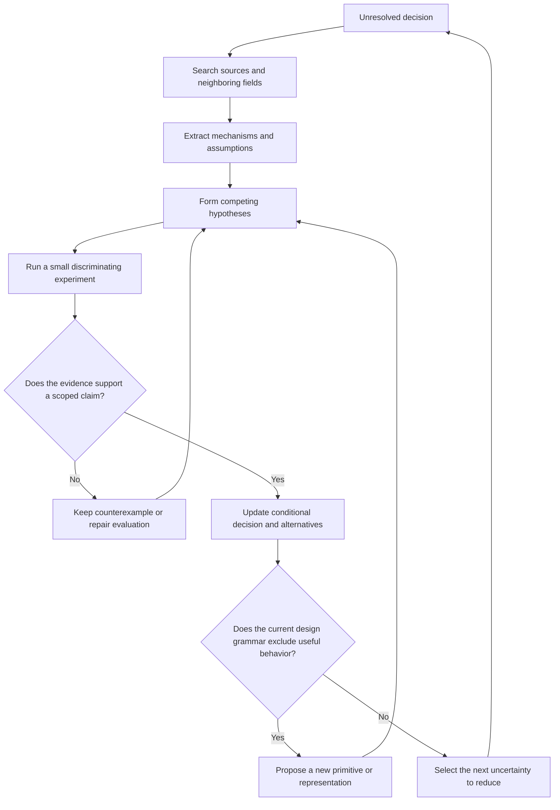

The transformer oracle can retrieve candidate sources, extract proposed mechanisms, suggest counterexamples, and generate experiment variants. Every factual claim still needs a checked source; every architecture claim still needs executable evidence. Store the supporting excerpts or document identifiers with the proposal so provenance is inspectable.

## 21. Cross-project experiment portfolio

These experiments combine mechanisms from the atlas. They are not claims that the cited systems already implement the combinations. Start with a CPU reference and add CUDA only when parallel candidate evaluation or an actual numerical backend makes it useful.

| ID and research question | Candidate designs and controls | What to measure and what would change the decision |
| --- | --- | --- |
| X01 — Can the runtime participate in its own live world? | A small reflective interpreter; a metaobject protocol; a runtime component represented as ordinary objects. Keep a conventional fixed runtime as control. | Change dispatch or allocation policy in a new semantic epoch. Measure reconstruction, interruption, and bootstrap dependence. Reject designs whose own inspection cannot distinguish active versions. |
| X02 — Can incomplete programs remain useful? | Hazel-style holes; suspended computations; placeholder objects; stop-on-error baseline. | Edit a running scene into an incomplete state and back. Check which outputs remain justified, how holes propagate, and whether external effects are correctly withheld. |
| X03 — Can the user edit the result and preserve source intent? | Direct object editing; bidirectional source/output updates; explicit source edits. | Change a graphical result with several possible source explanations. Measure ambiguity, source churn, task completion, and reproducibility of the chosen repair. |
| X04 — How much prior work survives an edit? | Full recomputation; memoization; Adapton-style demand tracking; differential updates. | Vary edit locality, dependency fanout, and retained history. Record repair time, memory growth, and exact agreement with recomputation. Cycles and invalidation storms are required cases. |
| X05 — Which concurrency restrictions buy useful determinism? | Kahn-style streams; monotone shared structures; logical-time actors; a recorded scheduler. | Run identical logical input under different physical schedules. Compare output/state hashes, expressiveness, buffering, deadlocks, and tail latency. Test each model under its own stated restrictions. |
| X06 — Can tentative worlds make risky edits cheap to explore? | Copy-on-write state branches; isolated transaction worlds; whole-state snapshots. | Fork several migrations and optimizer proposals, compare outcomes, and commit one. Measure retained state and merge conflicts. Effects go through an explicit adapter; copying state does not undo external actions. |
| X07 — Can optimization itself be a live inspectable object? | Exo-style schedule scripts; tracing specialization; equality saturation; conventional optimizing compiler. | Edit a source operation and inspect which transformations remain valid. Measure preserved work, explanation quality, compile time, and independently checked equivalence. |
| X08 — Does stronger checking improve useful search? | Random tests; property tests; bounded exhaustive checks; Rosette/SyGuS synthesis; translation validation; proof-checked proposals. | Use small rewrites and state migrations with known counterexamples. Measure false acceptance within the tested domain, rejected valid proposals, evaluator cost, and cost per useful accepted design. |
| X09 — What should a replaceable hardware region be? | SCORE-like pages; TRIPS-like blocks; WaveScalar-like resident instructions; ordinary kernel boundaries. | Hold semantics fixed and vary region size, state size, and edit arrival. Measure modeled boundary wait, discarded work, queue pressure, and mapping churn. |
| X10 — Where is reconfiguration bandwidth spent? | PipeRench-style virtualization; static mapping; mutable routes; mutable operations; different instruction stores. | Sweep modeled configuration bandwidth, storage, and routing. Report the full sensitivity range, including assumptions under which the ranking reverses. |
| X11 — Is a symbolic accelerator useful beside numerical kernels? | Reduceron-style graph operations; tagged object primitives; tensor operations; general CPU control. | Mix rewriting, allocation, pointer traversal, actor messages, and numerical work. A design must report its weak domains, not average them away behind a tensor-heavy score. |
| X12 — Can reflection coexist with limited authority? | Shared image mutation; explicit capabilities; isolated compartments; mediated debugger access. | Replace a component while retaining old references and asynchronous messages. Test authority, stale-reference behavior, recovery scope, and indirection costs. Capability safety alone is not deterministic execution. |
| X13 — Can policy and semantics change without losing replay? | Versioned effect handlers, schedulers, and validation policies. | Commit a policy transition, then replay across the boundary using both epochs' preserved artifacts. Compare intermediate states and effects; do not reinterpret old history under new rules. |
| X14 — Does preserving diversity uncover better architectures? | Scalar fitness; Pareto archive; MAP-Elites; bounded novelty pool. | Keep the same evaluation budget and compare behavior coverage, useful transfers, and held-out session performance. Freeze descriptors for each comparison, then evaluate descriptor revisions separately. |
| X15 — Can generated workloads expose blind spots? | Handwritten traces; property-based traces; oracle-generated traces; POET-inspired task/solution coevolution. | Preserve an untouched external suite. Reject meaningless tasks; keep minimal counterexamples. Compare whether new traces expose failures that ordinary optimization misses. |
| X16 — Which transformer role earns its cost? | No model; proposal generator; cost surrogate; test generator; proof proposer; natural-language construction interface. | Run separate ablations. Count inference, retrieval, evaluation, GPU interference, and review effort. Test frozen proposal batches first so architecture comparisons remain replayable. |
| X17 — Should English be a view over explicit semantic state? | English-centered records; explicit semantic state with English/visual views; the same state augmented by a replaceable learned workspace. | Use common edit tasks and independent reference behavior. Measure interpretation errors, ambiguity preservation, stale-view handling, replay without new model calls, explanation traceability, model replacement, and representation-extension cost. Assess understanding through paired human tasks. The [experiment outline](../../experiments/representation-comparison/README.md) defines the comparison; no variant has local results yet. |

### Choose a few tracks, not the whole table at once

Keep the initial visual pipeline as the integration demonstrator. Alongside it, choose one semantic experiment, one runtime/compiler experiment, and one hardware-model experiment. Each should have a small artifact, an explicit falsification condition, and a bounded evaluation budget. Promote combinations only after the individual mechanisms are understood.

A useful first set is X04 for incremental repair, X07 for inspectable optimization, and X09 for replacement granularity. X02 or X03 should run early if constructionist interaction is the main value proposition. X05 and X13 establish the determinism contract before autonomous search is allowed to commit changes.

Use X17 to challenge the representation baseline after the streaming-filter reference and edit protocol work. Compare the English-centered and explicit-state variants before adding a learned workspace. Keep their observable task requirements fixed, account for each variant's interpretation and execution bridge, and expose concepts the initial schema cannot express. The experiment must be able to reverse the provisional choice rather than assume its superiority.

These are starting priorities to revise, not claims that those branches will win. The atlas deliberately contains candidates that challenge the initial object/region/controller architecture.

## 22. Wisdom graphs, search diversity, and new architectures

### Use a graph of conditional claims

A decision can depend on several earlier findings, and a counterexample can affect several decisions. Store a graph rather than forcing all reasoning into a single tree. A readable wisdom tree is a selected view of that graph for a particular question.

```yaml
decision_id: W-region-004
question: Which region boundary best supports this workload family?
semantic_epoch: stream_v2
alternatives:
  - operator_boundary
  - virtual_compute_page
  - atomic_dataflow_block
conditions:
  workload_family: stateful_stream_with_schema_edits
  edit_distribution: trace_set_E12
evidence:
  - kind: P
    source: primary_source_reference
    scope: mechanism_precedent
  - kind: M
    artifact: results/E12/model_run.json
    scope: modeled_cycles_and_state_transfer
status: provisional
chosen_branch: REQUIRED_AFTER_EXPERIMENT
reversal_test: double_state_size_and_reduce_configuration_bandwidth
unresolved: calibration_of_physical_transfer_cost
parents: [W-state-002, W-effects-003]
```

Record rejected candidates without discarding their useful submechanisms. A configuration dominated on today's workload can remain valuable as a stepping stone, an explanation, or an occupant of a different behavior niche. Keep archive roles explicit: best measured choices, diverse valid alternatives, unsupported hypotheses, and known failures.

### Separate correctness, utility, and novelty

Correctness, required assurance, and declared resource limits are admission conditions. Utility records useful quantity, result quality, and editing-experience quality under section 11; keep their tradeoffs visible. Novelty measures difference in a declared behavioral space. These are separate signals; an unusual invalid program does not become useful by receiving a high novelty score.

MAP-Elites, novelty search, and POET supply different mechanisms for exploring beyond one objective or fixed task set; their primary sources and proposed experiments appear in the atlas. MAP-Elites motivates retaining distinct useful behaviors; POET motivates transferring stepping stones between challenges [80][ref-80], [82][ref-82]. They should be compared with simpler controls. A genetic algorithm is one candidate generator, not a prerequisite for a reprogrammable blob. None of these precedents guarantees escape from local optima in this project.

Reserve separate portfolio allocations for refinement, alternative mechanisms, and architecture discovery. The [research policy](../guides/autonomous-research.md#portfolio-and-stagnation-defaults) is the authority for provisional shares and review defaults. Account by a declared resource-cost measure, including failed builds, proposal generation, checking, and confirmation; trial count alone can hide unequal costs. Keep all resource dimensions visible and independently bounded. Do not silently divert exploration to the incumbent because it continues producing small gains.

Preserve several independently useful lineages and periodically test transfers between them. Sibling variations of the same winner do not establish broad coverage. Freeze behavior descriptors within a comparison and investigate their blind spots in separate campaigns. A descriptor map can exclude important behaviors just as a scalar objective can. Permit bounded multi-step explorations with temporary regressions, while keeping invalid candidates out of the accepted runtime.

Separate evidence of a performance gain from evidence that a question was resolved. A counterexample or failed hypothesis may justify a pivot without improving the incumbent. Record why the next allocation changes mechanism, starting point, workload family, or representation; renaming a stagnant branch is not a new search strategy. Generated workloads must remain connected to useful behavior and supplement untouched confirmation cases. New workloads or acceptance rules require versioned comparisons with rerun baselines.

### Change the search grammar explicitly

Use two connected processes:

- **Implementation search** operates inside a frozen semantic contract and a declared candidate grammar. Results are directly comparable.
- **Architecture discovery** may propose a new representation, instruction primitive, concurrency model, or semantic contract. It must also propose a reference interpretation, migration boundary where relevant, evaluation task, and cost assumptions. It enters a new experiment family rather than silently changing what the old scores mean.

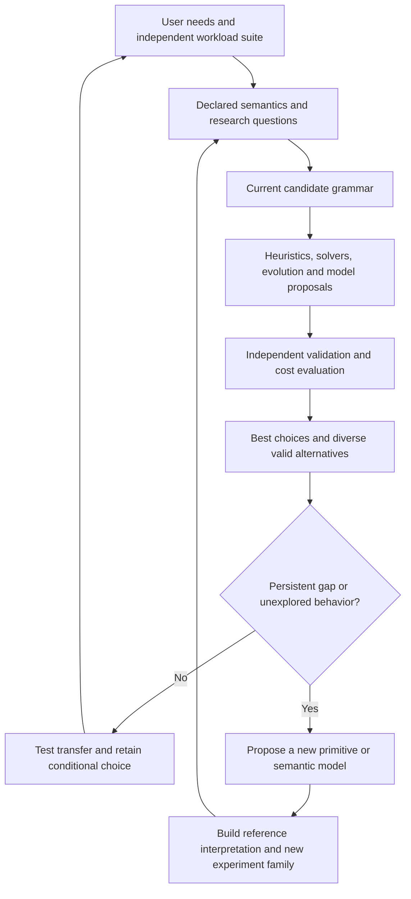

The deterministic controller may itself be replaced, but each committed history must identify the controller and semantics used at each step. The nondeterministic oracle can propose a new controller; it cannot quietly change the acceptance rules for the experiment currently judging its own candidate.

### Transformer roles beyond code generation

| Role | What a model may contribute | Deterministic boundary and evaluation |
| --- | --- | --- |
| Research assistant | Candidate mechanisms, source retrieval, contradictions, missing neighboring fields. | Preserve provenance; check sources; evaluate whether the proposal changes an actual research decision. |
| Construction partner | Translate intent, propose alternative repairs, explain live objects. | Present an explicit versioned edit; preserve ambiguity and allow direct inspection of the resulting change. |
| Search proposal engine | New primitives, schedules, representations, or mutations. | Typed proposal plus independent checks; record exact responses and artifacts. |
| Learned cost model | Rank expensive evaluations or predict stability. | Freeze the model for a trial, preserve its inputs, measure calibration and ranking errors, and retain an exploration path around its predictions. |
| Counterexample generator | Adversarial edit sequences, unusual states, failure scenarios. | Deterministically validate that the generated task is meaningful; retain independent tests that the generator cannot edit. |
| Proof or invariant proposer | Candidate invariants, lemmas, migration proofs, rewrite certificates. | A separate checker verifies the formal statement. Test that the statement actually captures the intended requirement. |

A learned component placed inside the strict execution path must meet that path's reproducibility contract. A component outside it may be nondeterministic if its outputs enter through the recorded event boundary. Classify by role and contract, rather than assuming every transformer must be either the whole controller or merely a chat interface.

## 23. Expanded research atlas

This is a broad, selective map of useful mechanisms, not an exhaustive history or a dependency list. Source-backed mechanisms are separated from proposed blob experiments. The experiments below are research recommendations; the cited projects do not establish their outcomes for this blob or the N1X.

### reflective runtimes

| Project | Mechanism and tradeoff | Proposed discriminating experiment |
| --- | --- | --- |
| CLOS Metaobject Protocol [37][ref-37] | Classes, generic functions, methods and slot definitions are represented by metaobjects; protocols expose how behavior and representation are implemented and how dependents are updated. Tradeoff: Customization competes with portable optimizer assumptions. The protocol explicitly limits portable redefinition and reinitialization; it is not unrestricted mutability. | Give a deterministic blob two selectable slot-storage or dispatch policies. Change policy through metaobjects, replay the same event log, and measure invalidation scope, migration work, and access overhead. |
| 3-Lisp and reflective towers [38][ref-38] | Procedural reflection gives a running process access to a causally connected representation of its evaluation state; reflective levels distinguish ordinary computation from computation about its interpreter. Tradeoff: A visible model must remain connected to execution. Unbounded reflection enlarges the semantic state and complicates efficient implementation; representation alone does not provide control. | Reify a blob continuation and environment, change one evaluation policy at an explicit boundary, then resume. Compare deterministic replay and optimization invalidation against a nonreflective interpreter. |
| Klein [39][ref-39] | An exploratory VM implemented in Self reused object-creation code across bootstrapping, running execution, and remote debugging, with reflective development tools and incremental updating. Tradeoff: The authors explicitly balance development-environment speed against architectural simplicity. Klein was incomplete when published; it is evidence for metacircular engineering techniques, not a completed universal platform. | Use one blob object-layout implementation for bootstrap, runtime, serializer and inspector. Change a layout and count duplicate mechanisms, update steps, debugger breakage, and required recompilation. |
| PyPy / RPython meta-tracing [40][ref-40] | RPython translates an interpreter implementation and can derive a tracing JIT that follows interpreter execution. Garbage collection is integrated during translation; explicit JIT hints guide useful tracing. Tradeoff: Sharing interpreter semantics reduces separate compiler work, but restricted implementation language, warm-up, tracing choices and invalidation remain real costs. A meta-tracer does not automatically make arbitrary interpreter changes cheap. | Implement the same blob evaluator with and without meta-tracing. Sweep stable-loop duration and semantic-edit frequency; measure warm-up, retained code, steady throughput, and recovery after edits. |
| VPRI Worlds [41][ref-41] | Program state becomes a first-class world mapping object identities and properties to values. Child worlds inherit state, isolate modifications, and can commit modifications to a parent. Tradeoff: Forked modeled state makes exploration convenient but adds lookup/storage costs and commit semantics. Physical or external effects require a separate policy; state rollback cannot reverse an already delivered external action. | Fork one deterministic blob into eight candidate-policy worlds, execute identical inputs, commit one, and verify replay plus absence of cross-world state leakage. |

### live construction

| Project | Mechanism and tradeoff | Proposed discriminating experiment |
| --- | --- | --- |
| VPRI STEPS / Frank / KScript [42][ref-42] | STEPS explored a compact personal-computing model built from cooperating languages, including Frank authoring and KScript/KSWorld, with an explicit translation chain and visualizers generated from language descriptions. Tradeoff: Small domain-specific descriptions can reduce semantic code while creating multiple translation and debugging boundaries. The report distinguishes meaning-bearing code from optimizations; line count alone is therefore an unsuitable performance or completeness score. | Implement one blob domain in a small language with a generated inspector; compare total tooling size, edit latency and debugging hops against a general-purpose implementation. |
| Lively Kernel [43][ref-43] | A browser-hosted graphical environment combines direct manipulation, scripting and development tools inside the live system, allowing applications and parts of the environment to be changed while running. Tradeoff: Integrated editing lowers tool boundaries, while browser/runtime services remain an external substrate. Persisting a graphical world does not automatically capture every external dependency, effect or reproducibility requirement. | Make the blob inspector itself live editable; change an inspector and behavior, save the world, reload independently, and compare state, dependency closure, event replay and modification effort. |
| Boxer [44][ref-44] | Nested visible boxes represent programs, variables, graphics and environments. Editing a variable's visible contents changes its value; program modifications update that visible representation, supporting personal reconstruction of existing tools. Tradeoff: Spatial organization and immediately visible state favor accessibility but must be tested for navigation, scale and hidden references. The original paper explicitly prioritizes understandability and small personal tasks over execution efficiency. | Compare novices modifying and reusing the same nested blob in spatial-box and text interfaces; measure successful changes, dependency understanding and serialization closure. |
| Hazel [45][ref-45] | Typed holes represent missing expressions and isolate errors or conflicts. Programs reachable through the editor's edit actions retain defined static and dynamic meanings, yielding possibly incomplete types and results. Tradeoff: Continuous feedback requires explicit semantics for incomplete states. Partial evaluation results cannot be treated automatically as permission to commit effects, and the approach depends on its language and editor calculus. | Delete a blob expression, type or pattern mid-edit. Compare typed-hole execution with last-good-version fallback for unaffected outputs, feedback latency and truthful explanation of suspended work. |
| Sketch-n-Sketch [46][ref-46] | Direct manipulation of rendered HTML/SVG output is connected to program transformations, including bidirectional evaluation that propagates output changes toward source changes and domain-specific update behavior. Tradeoff: An output change can correspond to many source edits. Candidate selection and domain-specific lenses are substantive design decisions; visual manipulation does not uniquely determine programmer intent. | Drag a blob's rendered output, produce candidate definition edits, require selection, then replay canonical events. Measure ambiguity, correction effort, preserved constraints and whether the resulting source remains understandable. |
| Unison [47][ref-47] | Definitions are identified by hashes of their syntax and dependencies, while human names are separate metadata. Immutable code identity supports durable dependency references and reuse of cached work. Tradeoff: Content identity improves version precision, but live names, state migration and effect handling still need explicit semantics. Hashing source dependencies does not itself guarantee deterministic external behavior. | Package blob code with immutable references and movable user-facing names. Upgrade definitions, migrate state and replay old versions; compare dependency reproducibility and migration complexity with mutable method identifiers. |

### incremental computation

| Project | Mechanism and tradeoff | Proposed discriminating experiment |
| --- | --- | --- |
| Adaptive Functional Programming / self-adjusting computation [48][ref-48] | Modifiable references and tracked dynamic dependencies support change propagation that updates a computation after input changes, including changes to the execution structure, with a formal correctness argument for the presented language. Tradeoff: Recording and maintaining dependency traces costs time and memory before reuse occurs. Sparse edits may benefit while dense edits erase the advantage; arbitrary effects or changed interpreter semantics require additional reasoning. | Sweep sparse-to-dense input edits in a deterministic blob and compare traced change propagation, memoized reruns and full reruns against an independent oracle. |
| Adapton [49][ref-49] | A demanded computation graph separates incremental computations from observers, postponing recomputation until outputs are demanded and enabling reuse when computations are rearranged within supported contexts. Tradeoff: Demand sensitivity avoids unused work but retains dependency and cache state. Reusing results after input edits is different from safely retaining them after arbitrary semantic changes; definition versions must participate in dependencies. | Give a blob several visible and hidden views. Edit inputs and versioned definitions, demand one view, and compare lazy incremental reuse, eager propagation and full reruns. |
| Naiad / timely dataflow [50][ref-50] | A dataflow execution model supports structured cycles and asynchronous messages while tracking progress through logical timestamps, coordinating when an iteration or epoch can be considered complete. Tradeoff: Progress tracking provides useful completion boundaries but carries metadata and coordination costs. Input updates and iterative execution do not automatically support arbitrary replacement of a running graph's code or topology. | Run a deterministic blob network with nested iterations and delayed messages. Introduce an edit epoch, wait for a valid progress boundary, then retire the old version; measure pause and tail latency. |
| Differential dataflow [51][ref-51] | Updates represented as differences are organized over partially ordered logical times, allowing incremental processing to compose with nested iterative computations rather than restarting an entire fixed point. Tradeoff: Indexed traces and differences consume memory, and large or adversarial updates can create substantial intermediate work. This mechanism incrementally maintains specified computations; changing their semantics remains a distinct lifecycle problem. | Maintain reachability in a blob dependency graph under edge edits, compare each result to fresh recomputation, and sweep graph density, edit size, iteration depth and retained-trace budgets. |

### deterministic semantics

| Project | Mechanism and tradeoff | Proposed discriminating experiment |
| --- | --- | --- |
| Kahn process networks [52][ref-52] | Deterministic sequential processes communicate through FIFO streams with blocking reads. The mathematical stream semantics separate results from process scheduling; channels are conceptually unbounded. Tradeoff: Finite memory and backpressure require an implementation policy. A deterministic result does not imply bounded buffers, termination, or a latency guarantee. | Run one stateful sensor graph under several fair schedules, then replace an operator at a declared stream epoch. Compare output hashes, buffer growth, blocked time, and edit latency. |
| Ptolemy II [53][ref-53] | Actors communicate through ports, while replaceable directors define execution semantics such as synchronous dataflow, discrete events, process networks, or synchronous/reactive behavior. Directors compose hierarchically. Tradeoff: Changing a director may change program meaning. Heterogeneous boundaries need explicit timing and communication contracts; one graphical representation does not guarantee one semantics. | Express a controller, stream processor, and event source under different directors. Measure which semantic combinations preserve a declared trace contract when the graph is edited. |
| LVars [54][ref-54] | Shared state grows monotonically through a specified lattice, and threshold reads restrict observable intermediate states. This permits deterministic parallel communication under the model's rules. Tradeoff: Arbitrary deletion, overwriting, and observations of incomplete state do not fit directly. Richer operations require additional protocols or weaker guarantees. | Accumulate independently validated candidates in a lattice-backed evidence set, then select from an explicitly closed batch. Compare schedule sensitivity, parallel speed, and coordination cost against a locked mutable registry. |
| Koka and algebraic effects [55][ref-55] | Function types track effects, including nondeterminism, state, exceptions, and I/O. Effect handlers define interpretations of operations while keeping the invoking computation separate. Tradeoff: Effect types alone do not make an arbitrary handler deterministic. Foreign calls and untracked effects can escape the intended replay boundary unless their interfaces are constrained. | Give oracle calls, timers, randomness, and device observations typed effects with live, recorded, and simulated handlers. Verify identical logical histories under replay and identify missing effect declarations. |

### authority/OS

| Project | Mechanism and tradeoff | Proposed discriminating experiment |
| --- | --- | --- |
| E vats and object capabilities [56][ref-56] | Each vat hosts objects and executes one event-loop turn at a time. Cross-vat interactions use asynchronous messages; object references carry authority in the object-capability model. Tradeoff: Run-to-completion turns avoid intra-vat races but do not impose one global delivery order. Distributed failure and ordering still require explicit treatment for replay. | Give a proposal generator only snapshot-inspection and proposal-submission capabilities. Attempt unauthorized mutation, vary message arrivals, and test whether the recorded ordering reproduces decisions without granting commit authority. |
| CHERI [57][ref-57] | Hardware-supported capabilities combine addresses with bounds, permissions, and integrity tags. Software defines protection policies that the architecture enforces for memory access and compartment boundaries. Tradeoff: Capabilities constrain authority but do not prove application semantics or determinism. Replacing the enforcing architecture changes the assumptions behind its guarantees. | In an executable processor model, compare checked handles with tagged capabilities while replacing a component. Inject forged references, out-of-bounds access, and stale references; specify temporal protection separately rather than assuming it. |
| seL4 [58][ref-58] | A capability-based microkernel has machine-checked correctness and security properties for specified configurations, with explicit assumptions and system-initialisation requirements. Tradeoff: Kernel proofs do not verify arbitrary applications, replacement kernels, or every hardware configuration. Reprogramming a verified component requires renewed evidence for the changed version. | Model a small protected service boundary, replace an untrusted service while retaining the boundary, and measure state-transfer cost and failure containment. Separately test the obligations created by changing the boundary itself. |
| Exokernel [59][ref-59] | A small kernel protects physical resources while untrusted library operating systems implement higher-level abstractions and resource-management policies. Libraries can be extended, specialised, or replaced. Tradeoff: Exposing control also transfers coordination and policy complexity to applications. Safe revocation and resource sharing remain obligations of the protected interface. | Give two blob regions different replaceable memory and I/O policies behind one resource-protection interface. Change policies during a workload and measure reclamation, isolation, migration cost, and end-to-end performance. |
| Barrelfish multikernel [60][ref-60] | The machine is treated as a network of cores, with OS functionality coordinated through explicit messages and replicated state rather than assuming one shared low-level kernel state. Tradeoff: Explicit communication supports heterogeneous implementations but adds protocols and consistency obligations. The architecture does not itself guarantee deterministic message histories. | Compare a shared scheduler with per-core simulated schedulers and a message protocol. Replace one scheduler version, inject delayed acknowledgements, and measure consistency, replay cost, and edit latency across core counts. |

### synthesis

| Project | Mechanism and tradeoff | Proposed discriminating experiment |
| --- | --- | --- |
| egg equality saturation [61][ref-61] | An e-graph compactly represents many equivalent expressions. Equality saturation applies rewrites without immediately choosing one sequence; analyses and extraction select an implementation under a cost model. Tradeoff: Soundness depends on valid rewrite rules and side conditions. Search growth and extraction cost can dominate, and a cost model can prefer implementations that perform poorly under edits. | Compare greedy rewriting, equality saturation, and evolutionary proposals for the same bounded kernel grammar. Include compilation and invalidation costs in extraction and validate each chosen implementation independently. |
| Rosette [62][ref-62] | Rosette extends Racket with symbolic execution and solver-backed synthesis and verification. Implementing a small language interpreter provides a route to solver-aided tools for that language. Tradeoff: The interpreter becomes part of the semantic model being trusted. Solver tractability and explicitly chosen bounds restrict which program families can be explored. | Encode a small blob instruction or migration language, synthesise candidate implementations, and compare them with an independently written concrete evaluator. Measure solver time, counterexample quality, and semantic mismatches. |
| Syntax-Guided Synthesis (SyGuS) [63][ref-63] | A synthesis problem combines a logical correctness specification, a background theory, and a grammar constraining candidate programs. Solvers seek a grammar member satisfying the specification. Tradeoff: A restrictive grammar improves tractability but may exclude useful designs. Failure to find a program does not establish that the broader architecture space has no solution. | Synthesize a bounded state-migration or dispatch function under several increasingly expressive grammars. Compare solver, evolutionary, and transformer-guided search while holding the correctness contract and total evaluation budget fixed. |
| Alive2 [64][ref-64] | SMT-backed translation validation checks whether an individual LLVM IR transformation is a valid refinement, including relevant undefined-behaviour semantics. Tradeoff: Bounded loop reasoning can miss bugs beyond the bound. The supported IR and transformation scope must be recorded; a successful check is not a proof of an entire evolving blob. | Have several proposal mechanisms rewrite small LLVM kernels, then independently validate each rewrite. Track rejected candidates, timeouts, unsupported cases, validation cost, and performance gains after all costs are included. |
| STOKE [65][ref-65] | Stochastic search explores x86-64 instruction sequences using correctness and performance costs. The project separates test-guided search from formal validation strategies with explicit instruction and loop support. Tradeoff: It is an archival research prototype with x86-specific assumptions, not a general current compiler replacement. Passing held-out tests is weaker than supported formal equivalence checking. | Reproduce the search principle on a small simulated ISA suitable for the host, comparing random, evolutionary, and solver-guided proposals. Preserve an independent validator and charge search time against useful execution savings. |

### Reconfigurable execution and virtualization

| Project | Mechanism and tradeoff | Proposed discriminating experiment |
| --- | --- | --- |
| PipeRench [66][ref-66] | Virtualizes pipeline configurations so logical pipelines can exceed physical fabric capacity; co-designs compiler and reconfigurable architecture. Tradeoff: Configuration traffic and stage reuse compete with throughput; pipelined kernels do not establish suitability for irregular mutable graphs. | Model physical stage count, logical depth, configuration bandwidth and edit frequency. Compare dedicated placement, time multiplexing and fallback; record modeled stalls and edit-to-first-output delay. |
| SCORE [67][ref-67] | Virtual compute pages communicate through streams; a runtime schedules computation and memory, with dynamic creation and destruction of pages and links. Tradeoff: Portability across fabric sizes introduces scheduling, buffering and backpressure costs; arbitrary version-to-version state migration remains a design obligation. | Run a token-stream graph with fewer physical slots than virtual pages. Inject edits and topology changes; compare static, dynamic and hybrid schedulers for deadlock, state retention, queue growth and edit latency. |

### Processor accelerator co-design

| Project | Mechanism and tradeoff | Proposed discriminating experiment |
| --- | --- | --- |
| Garp [68][ref-68] | Combines a conventional processor with an integrated reconfigurable coprocessor to retain general execution and accelerate selected work. Tradeoff: Transfer, setup and memory costs can erase specialization gains; the design does not itself provide reflective objects. | Sweep kernel size and modeled offload/setup costs; compare fine-grained and batched calls. Keep local CPU/CUDA observations separate from modeled target results. |
| DySER [69][ref-69] | LLVM transformations target dynamically specialized execution resources and support studies of separating memory access from configured computation datapaths. Tradeoff: Memory behavior and configuration amortization can dominate arithmetic speed; historical compiler and RTL dependencies may require bounded recovery work. | Model access/execute separation for stencils, pointer-heavy traversals and branching arithmetic. Sweep memory latency, queue capacity and stable-region duration; include setup and fallback costs. |

### Architecture search space

| Project | Mechanism and tradeoff | Proposed discriminating experiment |
| --- | --- | --- |
| MATRIX and RP-space [70][ref-70] | Models instruction resources and flexible interconnect as costs of programmability; MATRIX defers organization of instruction resources until runtime. Tradeoff: Programmable instruction storage and routing consume resources; arithmetic resource counts cannot establish physical area, power or timing. | Sweep processing-element width, instruction-storage organization, local memory and network flexibility under both stable and rapidly edited workloads; retain a modeled Pareto frontier. |

### Dataflow execution and update boundaries

| Project | Mechanism and tradeoff | Proposed discriminating experiment |
| --- | --- | --- |
| TRIPS and EDGE [71][ref-71] | Maps explicit data graphs onto distributed execution tiles; compiler-created blocks execute atomically and instructions communicate directly. Tradeoff: Larger blocks amortize execution costs but may increase draining, rollback and edit-to-effect latency; communication remains a physical constraint. | Vary block size and request edits during execution. Compare replacement at block commit with smaller replacement regions; record modeled discarded work, latency, utilization and contention. |
| WaveScalar [72][ref-72] | A dataflow ISA with sequential memory semantics keeps instructions mapped to processing elements across invocations and changes residency as the working set changes. Tradeoff: Persistent placement can reduce remapping while requiring memory-order, tag and communication machinery; simulation alone does not establish a feasible clock rate. | Model persistent graph placement and versioned edits. Sweep working-set size, placement capacity, memory-order constraints and change locality; measure modeled reconfiguration churn and execution delay. |

### Architecture exploration tooling

| Project | Mechanism and tradeoff | Proposed discriminating experiment |
| --- | --- | --- |
| CGRA-ME [73][ref-73] | Framework for modeling coarse-grained reconfigurable architectures and exploring architecture mapping and CAD choices. Tradeoff: Mapping quality competes with mapping time; documented older LLVM and Gurobi dependencies require a separate compatibility and licensing decision. | Map the same kernel and edit corpus onto several array sizes and connection patterns. Compare measured mapping time and modeled execution cost rather than selecting by execution cost alone. |
| OpenCGRA [74][ref-74] | Parameterized CGRA generator with configurable computing units and connections, simulation models and synthesizable Verilog output. Tradeoff: The documented dependency stack includes Python 3.7-era constraints; generated arrays do not automatically implement live state migration. | Generate tiny arrays from a common configuration schema, differentially test functional and cycle/RTL models, and vary unit mix and routing. Add explicit reconfiguration and state-transfer events. |

### Language hardware co-design

| Project | Mechanism and tradeoff | Proposed discriminating experiment |
| --- | --- | --- |
| Reduceron [75][ref-75] | Specializes a processor for lazy functional graph reduction using parallel memory access and hardware execution of semantic reduction rules. Tradeoff: Benefits are tied to graph-reduction semantics; symbolic workloads and allocation behavior differ from tensor kernels and require separate evaluation. | Compare generic interpretation with modeled reduction primitives on tree rewriting, shared graphs and allocation. Test changing reduction rules or object layouts at explicit state boundaries. |

### Authority and isolation

| Project | Mechanism and tradeoff | Proposed discriminating experiment |
| --- | --- | --- |
| CHERI [76][ref-76] | Co-designs capability semantics, hardware protection, compilers and operating systems to support protected references and compartmentalization. Tradeoff: Protected authority is distinct from fabric reconfiguration; arbitrary capability revocation and hot state migration are not automatically supplied. | Use functional emulation to give debugger and optimizer explicit authority. Attempt cross-compartment mutation, replace a compartment and examine stale references; compare modeled revocation and indirection strategies. |

### Programmable numerical acceleration

| Project | Mechanism and tradeoff | Proposed discriminating experiment |
| --- | --- | --- |
| VTA [77][ref-77] | Programmable tensor accelerator with a compiler, simulator, driver and JIT runtime spanning simulator and FPGA targets. Tradeoff: Tensor programmability is narrower than a general reflective runtime; changing accelerator structure has a different cost from changing its program. | Compare tensor-program edits with accelerator-parameter edits. Measure local compilation and JIT time; model tile sizes, precision, buffering and data movement, including a topology edit midway through a session. |
| Triton [78][ref-78] | A blocked program model supports compiler dataflow analysis and GPU-specific scheduling while exposing numerical kernel structure. Tradeoff: ARM64 CUDA build admission must be verified; numerical GPU performance does not establish the performance of proposed configurable silicon. | On an admitted build, measure a changing-kernel session including initial compilation, cached execution, shape changes and source edits. Compare complete session cost with CUDA C++ and CPU baselines. |

### Inspectable compiler transformations

| Project | Mechanism and tradeoff | Proposed discriminating experiment |
| --- | --- | --- |
| Exo [79][ref-79] | Separates algorithm descriptions from explicit programmable schedules that transform program ASTs and expose hardware-specific optimization steps. Tradeoff: Optimization provenance is inspectable, but stateful live activation replacement is not provided by scheduling alone. | Search schedules for a fixed algorithm, then edit the algorithm and identify invalidated schedule steps. Record numerical agreement, rebuild time and wasted optimization effort. |

### Open-ended discovery and model-assisted search

| Project | Mechanism and tradeoff | Proposed discriminating experiment |
| --- | --- | --- |
| MAP-Elites [80][ref-80] | Keeps strong candidates across a user-defined behavior map instead of returning only one best design. Tradeoff: The descriptors and discretization determine what diversity is visible; coverage is not proof of usefulness. | Archive valid blob variants by replacement granularity and state-reconstruction cost. Compare niche coverage and held-out performance against a Pareto-only archive under equal budgets. |
| Autoresearch [109][ref-109], [110][ref-110] | Uses a narrow editable implementation, fixed evaluation, and an agent-directed trial loop. Tradeoff: A single incumbent and metric can restrict exploration; local result logging needs an explicit retention policy. | Compare a simple agent loop with a portfolio of independent lineages on the streaming filter. Hold semantics and total research cost fixed; measure validated session gains, useful transfers, and retained counterexamples. |
| Novelty search [81][ref-81] | Searches behavioral novelty to explore beyond deceptive objective gradients. Tradeoff: Behavior descriptors can reward irrelevant novelty. Correctness and resource constraints still need independent enforcement. | Reserve a bounded exploration pool for unusual but valid edit and execution behaviors. Test whether it supplies later useful variants that performance-only search misses. |
| POET and Enhanced POET [82][ref-82] | Generates challenges alongside solutions and transfers solutions between challenges. Tradeoff: Self-generated tasks can drift away from user needs; the original demonstration does not establish open-ended architecture discovery. | Coevolve edit traces and candidate runtimes, while preserving an untouched external benchmark. Require each new trace to have deterministic semantics and a reason it represents useful behavior. |
| AlphaTensor [83][ref-83] | Uses learned search to discover matrix multiplication algorithms; the repository supplies discovered algorithms and verification material. Tradeoff: An algebraic improvement does not automatically improve runtime, numerical error, or editing cost on a different device. | Search a tiny exact arithmetic kernel space and verify candidates independently. Then measure physical CPU/CUDA session cost, including compilation and changing shapes. |
| AlphaDev [84][ref-84] | Searches low-level program sequences for improved algorithms, including small sorting routines. Tradeoff: Instruction count and measured latency can rank programs differently; low-level wins may depend on the target ISA. | Compare learned, stochastic, and enumerative search for a small blob primitive with an exhaustive finite input domain. Measure latency and edit metadata costs separately. |
| LeanDojo and ReProver [85][ref-85] | Connects language-model proof proposals and premise retrieval to an interactive Lean environment. Tradeoff: Proof checking establishes the formal statement under its assumptions; it does not show the specification captured user intent or measured performance. | Ask an oracle for a proof of one bounded rewrite or migration invariant. Compare proof-guided proposals with tests alone, keeping proof checking and the intended contract independent of the oracle. |

## 24. References

Sources checked on 31 October 2026. Links identify primary papers, author or institutional repositories, and project documentation. Historical results are precedents, not performance predictions for this proposal. Some papers require publisher access; no access to unavailable full text is implied.

1. [Self dynamic deoptimization][ref-1] — Hölzle, Chambers and Ungar, PLDI 1992. Optimized debugging and live changes.

2. [Self adaptive optimization][ref-2] — Hölzle, Stanford dissertation, 1994. Responsiveness, type feedback and compilation economics.

3. [Partial Evaluation in Truffle][ref-3] — GraalVM documentation. Speculation, stable interpreter structure and invalidation.

4. [Directness and Liveness in Morphic][ref-4] — Maloney and Smith, UIST 1995. Live graphical construction.

5. [Squeak Smalltalk][ref-5] — Project documentation. Inspectable tools, Morphic, and constructionist authoring.

6. [The Symbolics Virtual Lisp Machine][ref-6] — Withington, McKay, Palter and Robertson, 1994 extended abstract. Preserving tagged machine semantics in emulation.

7. [Erlang Release Handling][ref-7] — Official documentation. State conversion and dependencies during live upgrades.

8. [Practical Dynamic Software Updating for C][ref-8] — Neamtiu et al., PLDI 2006. Ginseng update mechanisms and their measured costs.

9. [McCLIM User Manual][ref-9] — Project documentation. Semantic presentations and typed input.

10. [Glamorous Toolkit and Pharo][ref-10] — Project documentation. Contextual tools and moldable development.

11. [Plasticine][ref-11] — Prabhakar et al., ISCA 2017. Reconfigurable architecture for parallel patterns.

12. [Spatial][ref-12] — Koeplinger et al., PLDI 2018. Language and compiler for application accelerators.

13. [Coarse Grained FPGA Overlay for Rapid JIT Compilation][ref-13] — Jain, Maskell and Fahmy, IEEE TPDS, online 2021; volume 33, 2022. Runtime mapping to a coarse overlay.

14. [CIRCT][ref-14] — LLVM project. Hardware intermediate representations and compiler infrastructure.

15. [Chipyard Components][ref-15] — Project documentation. Processor, accelerator and interconnect generators with simulation flows.

16. [The path to ubiquitous AI][ref-16] — Taalas technical description. Model specialization and the published HC1 flexibility boundary.

17. [Ansor][ref-17] — Zheng et al., OSDI 2020. Evolutionary schedule search with learned cost models.

18. [BOHB][ref-18] — Falkner, Klein and Hutter, ICML 2018. Model-guided configuration search with evaluation budgets.

19. [NSGA II][ref-19] — Deb et al., IEEE TEC 2002. Constrained multiobjective evolutionary search. Publisher full text may require access.

20. [An evolved circuit intrinsic in silicon entwined with physics][ref-20] — Thompson, ICES 1996 proceedings, published 1997. Physical evaluation in evolutionary circuit design.

21. [CUDA Toolkit release notes][ref-21] — NVIDIA, CUDA 13.4 Update 2 as retrieved. Native Windows Arm support is distinct from WSL validation.

22. [CUDA on WSL User Guide][ref-22] — NVIDIA documentation. Driver model, container workflow and capability limitations.

23. [Basic commands for WSL][ref-23] — Microsoft Learn. Package versions and WSL 1 or 2 distribution mode.

24. [Docker Desktop on Windows][ref-24] — Docker documentation. Windows Arm installation and current backend support.

25. [Docker multi platform builds][ref-25] — Docker documentation. Native images, architecture manifests and emulation.

26. [Working across Windows and Linux filesystems][ref-26] — Microsoft Learn. Recommended location for Linux build and project files.

27. [NVRTC documentation][ref-27] — NVIDIA. Runtime compilation of CUDA C++ and loading generated executable code.

28. [CUDA Graphs][ref-28] — NVIDIA CUDA Programming Guide. Instantiation, update restrictions and execution semantics.

29. [QEMU TCG Instruction Counting][ref-29] — QEMU documentation. Instruction counting is not cycle-accurate emulation.

30. [gem5 architecture simulation][ref-30] — Project overview. Interchangeable processor models and system simulation.

31. [FunSearch][ref-31] — Romera-Paredes et al., Nature, published online 2023. Language-model program proposals paired with systematic evaluation.

32. [AlphaEvolve][ref-32] — Google DeepMind, 2025 project account. Model-assisted evolutionary discovery with automated evaluators.

33. [PyTorch reproducibility][ref-33] — Official documentation source. Random seeds, deterministic operations and cross-platform limitations.

34. [QEMU user space emulator][ref-34] — Official documentation. User-mode instruction and system-call translation, including execution inside containers.

35. [QEMU system emulation introduction][ref-35] — Official documentation. Guest machines, TCG, accelerators, and device models.

36. [QEMU RISC-V virt platform][ref-36] — Official documentation. Generic virtual board and direct kernel boot; used only for a functional smoke-test example.

37. [The Common Lisp Object System Metaobject Protocol — Concepts][ref-37] — Primary project source or research paper. Used for the mechanism described in the atlas.

38. [Brian Cantwell Smith — Reflection and Semantics in Lisp (1984)][ref-38] — Primary project source or research paper. Used for the mechanism described in the atlas.

39. [Constructing a Metacircular Virtual Machine in an Exploratory Programming Environment (2005)][ref-39] — Primary project source or research paper. Used for the mechanism described in the atlas.

40. [PyPy Architecture][ref-40] — Primary project source or research paper. Used for the mechanism described in the atlas.

41. [Alessandro Warth and Alan Kay — Worlds: Controlling the Scope of Side Effects (2008)][ref-41] — Primary project source or research paper. Used for the mechanism described in the atlas.

42. [STEPS Toward the Reinvention of Programming — 2012 Final Report][ref-42] — Primary project source or research paper. Used for the mechanism described in the atlas.

43. [The Lively Kernel — A Technical Overview (2008)][ref-43] — Primary project source or research paper. Used for the mechanism described in the atlas.

44. [Andrea diSessa and Harold Abelson — Boxer: A Reconstructible Computational Medium (1986)][ref-44] — Primary project source or research paper. Used for the mechanism described in the atlas.

45. [Hazel — Live functional programming with typed holes][ref-45] — Primary project source or research paper. Used for the mechanism described in the atlas.

46. [Sketch-n-Sketch — Direct manipulation programming][ref-46] — Primary project source or research paper. Used for the mechanism described in the atlas.

47. [Unison — The big idea][ref-47] — Primary project source or research paper. Used for the mechanism described in the atlas.

48. [Umut Acar, Guy Blelloch and Robert Harper — Adaptive Functional Programming (2006)][ref-48] — Primary project source or research paper. Used for the mechanism described in the atlas.

49. [Adapton: Composable, Demand-Driven Incremental Computation — Technical report (2013)][ref-49] — Primary project source or research paper. Used for the mechanism described in the atlas.

50. [Microsoft Research — Naiad][ref-50] — Primary project source or research paper. Used for the mechanism described in the atlas.

51. [Composable Incremental and Iterative Data-Parallel Computation with Naiad (2012)][ref-51] — Primary project source or research paper. Used for the mechanism described in the atlas.

52. [Gilles Kahn, The Semantics of a Simple Language for Parallel Programming (1974)][ref-52] — Primary project source or research paper. Used for the mechanism described in the atlas.

53. [Ptolemy II: actor-oriented design and heterogeneous models of computation][ref-53] — Primary project source or research paper. Used for the mechanism described in the atlas.

54. [LVars: Lattice-based Data Structures for Deterministic Parallelism (FHPC 2013)][ref-54] — Primary project source or research paper. Used for the mechanism described in the atlas.

55. [The Koka Programming Language: effect typing and effect handlers][ref-55] — Primary project source or research paper. Used for the mechanism described in the atlas.

56. [E language documentation: The Vat][ref-56] — Primary project source or research paper. Used for the mechanism described in the atlas.

57. [CHERI Frequently Asked Questions: capabilities and compartmentalisation][ref-57] — Primary project source or research paper. Used for the mechanism described in the atlas.

58. [seL4 Proofs: verification scope, configuration, and assumptions][ref-58] — Primary project source or research paper. Used for the mechanism described in the atlas.

59. [Exokernel: An Operating System Architecture for Application-Level Resource Management (SOSP 1995)][ref-59] — Primary project source or research paper. Used for the mechanism described in the atlas.

60. [The Multikernel: A new OS architecture for scalable multicore systems (SOSP 2009)][ref-60] — Primary project source or research paper. Used for the mechanism described in the atlas.

61. [egg: Fast and Extensible Equality Saturation (POPL 2021)][ref-61] — Primary project source or research paper. Used for the mechanism described in the atlas.

62. [Rosette: solver-aided programming for synthesis and verification][ref-62] — Primary project source or research paper. Used for the mechanism described in the atlas.

63. [SyGuS: semantic specifications, background theories, and implementation grammars][ref-63] — Primary project source or research paper. Used for the mechanism described in the atlas.

64. [Alive2: Bounded Translation Validation for LLVM (PLDI 2021)][ref-64] — Primary project source or research paper. Used for the mechanism described in the atlas.

65. [STOKE research artifact: stochastic superoptimization and formal validation][ref-65] — Primary project source or research paper. Used for the mechanism described in the atlas.

66. [PipeRench A Reconfigurable Architecture and Compiler][ref-66] — Primary project source or research paper. Used for the mechanism described in the atlas.

67. [SCORE Overview][ref-67] — Primary project source or research paper. Used for the mechanism described in the atlas.

68. [Garp A MIPS Processor with a Reconfigurable Coprocessor][ref-68] — Primary project source or research paper. Used for the mechanism described in the atlas.

69. [DySER Compiler][ref-69] — Primary project source or research paper. Used for the mechanism described in the atlas.

70. [Reconfigurable Architectures for General-Purpose Computing][ref-70] — Primary project source or research paper. Used for the mechanism described in the atlas.

71. [TRIPS Technical Overview][ref-71] — Primary project source or research paper. Used for the mechanism described in the atlas.

72. [The WaveScalar Architecture][ref-72] — Primary project source or research paper. Used for the mechanism described in the atlas.

73. [Getting Started with CGRA-ME][ref-73] — Primary project source or research paper. Used for the mechanism described in the atlas.

74. [OpenCGRA README][ref-74] — Primary project source or research paper. Used for the mechanism described in the atlas.

75. [The Reduceron Reconfigured][ref-75] — Primary project source or research paper. Used for the mechanism described in the atlas.

76. [Capability Hardware Enhanced RISC Instructions][ref-76] — Primary project source or research paper. Used for the mechanism described in the atlas.

77. [VTA Hardware Design Stack][ref-77] — Primary project source or research paper. Used for the mechanism described in the atlas.

78. [Triton Introduction][ref-78] — Primary project source or research paper. Used for the mechanism described in the atlas.

79. [The Exo Language Tutorial][ref-79] — Primary project source or research paper. Used for the mechanism described in the atlas.

80. [Illuminating search spaces by mapping elites][ref-80] — Mouret and Clune, 2015. Original quality-diversity search paper.

81. [Abandoning Objectives: Evolution Through the Search for Novelty Alone][ref-81] — Lehman and Stanley, 2011. Author-institution record and abstract.

82. [Enhanced POET: Open-ended Reinforcement Learning through Unbounded Invention of Learning Challenges and their Solutions][ref-82] — Wang et al., ICML 2020. Coevolution of challenges and their solutions.

83. [AlphaTensor: discovering faster matrix multiplication algorithms][ref-83] — Google DeepMind research repository accompanying the 2022 Nature paper.

84. [AlphaDev discovers faster sorting algorithms][ref-84] — Google DeepMind, 2023. Project account of reinforcement learning over low-level programs.

85. [LeanDojo: Theorem Proving with Retrieval-Augmented Language Models][ref-85] — Yang et al., NeurIPS 2023. Primary paper; used as a historical mechanism, not a current installation recipe.

86. [NVIDIA Warp documentation][ref-86] — CPU/GPU kernel generation, differentiable simulation, physics, and geometry.

87. [GATSPI: GPU Accelerated Gate-Level Simulation for Power Improvement][ref-87] — NVIDIA Research, DAC 2022; gate simulation and switching/power analysis.

88. [GL0AM research artifact][ref-88] — NVIDIA Research repository; GPU logic simulation, graph partitioning, and waveform processing.

89. [SPADES: Solver for PArallel Discrete Event Simulation][ref-89] — Primary project repository; conservative and optimistic event synchronization on heterogeneous hardware.

90. [CUDA C++ Best Practices Guide][ref-90] — NVIDIA documentation; memory layouts, data movement, and measured optimization.

91. [CUDA Programming Guide: Writing SIMT Kernels][ref-91] — NVIDIA documentation; threads, blocks, and execution organization.

92. [cuRAND Device API Overview][ref-92] — NVIDIA documentation; random generator state and sequence controls.

93. [Floating Point and IEEE 754][ref-93] — NVIDIA technical documentation; numerical ordering and CPU/GPU differences.

94. [CCCL determinism documentation][ref-94] — NVIDIA development documentation; operation-specific reproducibility requirements. Pin and verify an admitted release before use.

95. [CUDA Core Compute Libraries][ref-95] — NVIDIA primary repository; CUB, Thrust, and CUDA C++ building blocks.

96. [Compute Sanitizer documentation][ref-96] — NVIDIA documentation; memory and synchronization diagnostics.

97. [Nsight Systems User Guide][ref-97] — NVIDIA documentation; profiling application timelines and CUDA activity.

98. [Lean: Validating a Lean Proof][ref-98] — Official documentation; statement meaning, proof checking, and replay.

99. [Lean: Axioms][ref-99] — Official documentation; assumptions, incomplete proofs, and native evaluation.

100. [Lean compiler: implemented_by][ref-100] — Official API documentation; unchecked implementation substitution and equality-backed csimp.

101. [Lean: Foreign Function Interface][ref-101] — Official documentation; external runtime implementations and their interface.

102. [Lean FAQ: trusted code base][ref-102] — Official explanation of proof-checking trust versus compiled execution and external code.

103. [About the Rocq Prover][ref-103] — Official project overview and Coq-to-Rocq name history.

104. [CompCert C: a trustworthy compiler][ref-104] — Official manual; semantic preservation and the precise verification boundary.

105. [Verified Software Toolchain][ref-105] — Princeton project source; Verifiable C and separation-logic verification.

106. [Iris Project][ref-106] — Primary project source; concurrent separation logic, Rocq development, and linked Lean port.

107. [Kami: a modular deductive hardware verification platform][ref-107] — MIT CSAIL project overview; specifications, proofs, and circuit extraction.

108. [bedrock2][ref-108] — MIT PLV research repository; low-level verification and RISC-V compilation.

109. [Autoresearch][ref-109] — Karpathy's primary repository; small autonomous training experiments with a fixed evaluation and bounded training time.

110. [Autoresearch experiment instructions][ref-110] — Primary procedure for editable scope, baseline establishment, trial logging, and candidate retention or reset. Blob's adaptations are proposals, not results from this source.

111. [Verbalizable Representations Form a Global Workspace in Language Models][ref-111] — Gurnee et al., Transformer Circuits, 2026. Jacobian lens and J-space experiments; a research precedent, not a portable application-state specification.

112. [CQRS][ref-112] — Martin Fowler, 2011. Separate command and query models and their applicability limits.

113. [Event Sourcing][ref-113] — Martin Fowler, 2005. Recorded state changes, reconstruction, and replay; distinct from CQRS.

[ref-1]: https://bibliography.selflanguage.org/dynamic-deoptimization.html
[ref-2]: https://bibliography.selflanguage.org/urs-thesis.html
[ref-3]: https://www.graalvm.org/dev/graalvm-as-a-platform/language-implementation-framework/PartialEvaluation/
[ref-4]: https://bibliography.selflanguage.org/directness.html
[ref-5]: https://squeak.org/
[ref-6]: https://www.chai.uni-hamburg.de/~moeller/symbolics-info/literature/VLM.html
[ref-7]: https://www.erlang.org/doc/system/release_handling.html
[ref-8]: https://www.cs.umd.edu/~mwh/papers/neamtiu06dsu.html
[ref-9]: https://mcclim.common-lisp.dev/static/manual/mcclim.html
[ref-10]: https://book.gtoolkit.com/glamorous-toolkit-and-pharo-6k5konpjjknm9u90y4t6le5po
[ref-11]: https://mast.stanford.edu/pubs/plasticine_a_reconfigurable_accelerator_for_parallel_patterns/
[ref-12]: https://mast.stanford.edu/pubs/spatial_a_language_and_compiler_for_application_accelerators/
[ref-13]: https://wrap.warwick.ac.uk/id/eprint/160012/
[ref-14]: https://circt.llvm.org/
[ref-15]: https://chipyard.readthedocs.io/en/stable/Chipyard-Basics/Chipyard-Components.html
[ref-16]: https://taalas.com/the-path-to-ubiquitous-ai/
[ref-17]: https://www.usenix.org/conference/osdi20/presentation/zheng
[ref-18]: https://proceedings.mlr.press/v80/falkner18a.html
[ref-19]: https://doi.org/10.1109/4235.996017
[ref-20]: https://link.springer.com/chapter/10.1007/3-540-63173-9_61
[ref-21]: https://docs.nvidia.com/cuda/cuda-toolkit-release-notes/
[ref-22]: https://docs.nvidia.com/cuda/wsl-user-guide/
[ref-23]: https://learn.microsoft.com/en-us/windows/wsl/basic-commands
[ref-24]: https://docs.docker.com/desktop/setup/install/windows-install/
[ref-25]: https://docs.docker.com/build/building/multi-platform/
[ref-26]: https://learn.microsoft.com/en-us/windows/wsl/filesystems
[ref-27]: https://docs.nvidia.com/cuda/nvrtc/index.html
[ref-28]: https://docs.nvidia.com/cuda/cuda-programming-guide/04-special-topics/cuda-graphs.html
[ref-29]: https://www.qemu.org/docs/master/devel/tcg-icount.html
[ref-30]: https://www.gem5.org/about/
[ref-31]: https://www.nature.com/articles/s41586-023-06924-6
[ref-32]: https://deepmind.google/blog/alphaevolve-a-gemini-powered-coding-agent-for-designing-advanced-algorithms/
[ref-33]: https://github.com/pytorch/pytorch/blob/main/docs/source/notes/randomness.md
[ref-34]: https://www.qemu.org/docs/master/user/main.html
[ref-35]: https://www.qemu.org/docs/master/system/introduction.html
[ref-36]: https://www.qemu.org/docs/master/system/riscv/virt.html
[ref-37]: https://franz.com/support/documentation/mop/concepts.html
[ref-38]: https://ics.uci.edu/~jajones/INF102-S18/readings/17_Smith84.pdf
[ref-39]: https://www.oopsla.org/2005/ShowEvent850a.html
[ref-40]: https://doc.pypy.org/architecture.html
[ref-41]: https://tinlizzie.org/VPRIPapers/rn2008001_worlds.pdf
[ref-42]: https://tinlizzie.org/VPRIPapers/tr2012001_steps.pdf
[ref-43]: https://lively-kernel.org/development/media/LivelyKernel-TechnicalOverview.pdf
[ref-44]: https://boxer-project.github.io/boxer-literature/papers/Boxer,%20A%20Reconstructible%20Computational%20Medium%20(diSessa%20&%20Abelson,%201986).pdf
[ref-45]: https://hazel.org/
[ref-46]: https://ravichugh.github.io/sketch-n-sketch/
[ref-47]: https://www.unison-lang.org/docs/the-big-idea/
[ref-48]: https://www.cs.cmu.edu/~rwh/papers/afp/toplas06.pdf
[ref-49]: https://drum.lib.umd.edu/items/b7401a53-964b-4f78-8b2d-a93ab750bb0a
[ref-50]: https://www.microsoft.com/en-us/research/project/naiad/
[ref-51]: https://www.microsoft.com/en-us/research/publication/composable-incremental-and-iterative-data-parallel-computation-with-naiad/
[ref-52]: https://www.cs.columbia.edu/~sedwards/papers/kahn1974semantics.pdf
[ref-53]: https://ptolemy.berkeley.edu/ptolemyII/index.htm
[ref-54]: https://users.soe.ucsc.edu/~lkuper/papers/lvars-fhpc13.pdf
[ref-55]: https://koka-lang.github.io/koka/doc/book.html
[ref-56]: https://www.erights.org/elib/concurrency/vat.html
[ref-57]: https://www.cl.cam.ac.uk/research/security/ctsrd/cheri/cheri-faq.html
[ref-58]: https://sel4.systems/Verification/proofs
[ref-59]: https://pdos.csail.mit.edu/6.828/2008/readings/engler95exokernel.pdf
[ref-60]: https://barrelfish.org/publications/barrelfish_sosp09.pdf
[ref-61]: https://arxiv.org/abs/2004.03082
[ref-62]: https://emina.github.io/rosette/
[ref-63]: https://sygus-org.github.io/
[ref-64]: https://users.cs.utah.edu/~regehr/alive2-pldi21.pdf
[ref-65]: https://github.com/StanfordPL/stoke/blob/develop/README.md
[ref-66]: https://www.cs.cmu.edu/~seth/papers/goldstein-ieee00.html
[ref-67]: https://brass.cs.berkeley.edu/SCORE/overview.html
[ref-68]: https://brass.cs.berkeley.edu/documents/GarpProcessor.html
[ref-69]: https://research.cs.wisc.edu/vertical/dyser-compiler/
[ref-70]: https://dspace.mit.edu/entities/publication/73d98796-ac55-41eb-9ece-ab3bde0c8870
[ref-71]: https://www.cs.utexas.edu/~cart/trips/overview.html
[ref-72]: https://www.microsoft.com/en-us/research/publication/the-wavescalar-architecture/
[ref-73]: https://cgra-me.ece.utoronto.ca/docs/
[ref-74]: https://github.com/pnnl/OpenCGRA/blob/master/README.md
[ref-75]: https://mn416.github.io/reduceron-project/report.pdf
[ref-76]: https://www.cl.cam.ac.uk/research/security/ctsrd/cheri/index.html
[ref-77]: https://github.com/apache/tvm-vta/blob/main/README.md
[ref-78]: https://triton-lang.org/main/programming-guide/chapter-1/introduction.html
[ref-79]: https://exo-lang.dev/tutorial.html
[ref-80]: https://arxiv.org/abs/1504.04909
[ref-81]: https://stars.library.ucf.edu/facultybib2010/1530/
[ref-82]: https://proceedings.mlr.press/v119/wang20l.html
[ref-83]: https://github.com/google-deepmind/alphatensor
[ref-84]: https://deepmind.google/blog/alphadev-discovers-faster-sorting-algorithms/
[ref-85]: https://proceedings.neurips.cc/paper_files/paper/2023/hash/4441469427094f8873d0fecb0c4e1cee-Abstract-Datasets_and_Benchmarks.html

[ref-86]: https://nvidia.github.io/warp/stable/
[ref-87]: https://research.nvidia.com/publication/2022-03_gatspi-gpu-accelerated-gate-level-simulation-power-improvement
[ref-88]: https://github.com/NVlabs/GL0AM
[ref-89]: https://github.com/NatLabRockies/spades
[ref-90]: https://docs.nvidia.com/cuda/cuda-c-best-practices-guide/index.html
[ref-91]: https://docs.nvidia.com/cuda/cuda-programming-guide/02-basics/writing-cuda-kernels.html
[ref-92]: https://docs.nvidia.com/cuda/curand/device-api-overview.html
[ref-93]: https://docs.nvidia.com/cuda/floating-point/index.html
[ref-94]: https://nvidia.github.io/cccl/unstable/cccl/determinism.html
[ref-95]: https://github.com/NVIDIA/cccl
[ref-96]: https://docs.nvidia.com/compute-sanitizer/ComputeSanitizer/index.html
[ref-97]: https://docs.nvidia.com/nsight-systems/UserGuide/

[ref-98]: https://lean-lang.org/doc/reference/latest/ValidatingProofs/
[ref-99]: https://lean-lang.org/doc/reference/latest/Axioms/
[ref-100]: https://lean-lang.org/doc/api/Lean/Compiler/ImplementedByAttr.html
[ref-101]: https://lean-lang.org/doc/reference/latest/Run-Time-Code/Foreign-Function-Interface/
[ref-102]: https://lean-lang.org/faq/

[ref-103]: https://rocq-prover.org/about
[ref-104]: https://compcert.org/man/manual001.html
[ref-105]: https://vst.cs.princeton.edu/
[ref-106]: https://iris-project.org/
[ref-107]: https://www.csail.mit.edu/research/kami-modular-deductive-hardware-verification-platform
[ref-108]: https://github.com/mit-plv/bedrock2
[ref-109]: https://github.com/karpathy/autoresearch
[ref-110]: https://github.com/karpathy/autoresearch/blob/master/program.md
[ref-111]: https://transformer-circuits.pub/2026/workspace/
[ref-112]: https://martinfowler.com/bliki/CQRS.html
[ref-113]: https://martinfowler.com/eaaDev/EventSourcing.html
